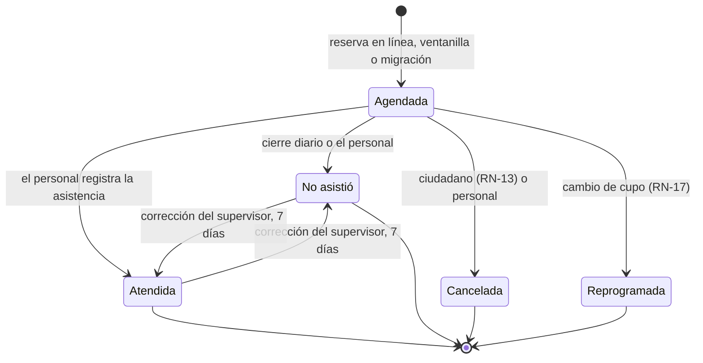

# 03 · Reglas de negocio

Todas las reglas se validan en el servidor, en `Tiie.Dominio` y `Tiie.Aplicacion`. El frontend puede anticiparlas para dar retroalimentación, pero la decisión es siempre del backend. Cada regla tiene pruebas cuyo nombre incluye su ID.

## Reloj y zona horaria

- La zona de negocio es `America/Mazatlan` (Sinaloa, UTC-7 sin horario de verano desde 2022). Se configura en `Agenda:ZonaHoraria`.
- **Hoy** es la fecha local que resulta de convertir `TimeProvider.GetUtcNow()` a esa zona. Lo calcula `RelojAgenda`; nadie más.
- Las fechas de cita son `DateOnly` y las horas `TimeOnly`, siempre locales. Los instantes (creación, envío, auditoría) son `DateTimeOffset` en UTC.
- Una hora de cupo «ya pasó» cuando `Fecha + Hora` local es anterior al instante actual en la zona de negocio.

## Catálogo de reglas

| ID | Regla | Configurable | Código de error |
| --- | --- | --- | --- |
| RN-01 | Un solicitante (CURP) solo puede tener una cita Agendada | — | `YaTieneCita` |
| RN-02 | Un cupo no admite más citas que su capacidad | — | `SinCupo` |
| RN-03 | Se reserva desde mañana hasta hoy + `DiasVentana` de la oferta | Por oferta, 1 a 120; 49 por omisión | `FueraDeVentana` |
| RN-04 | Las horas y turnos de cada día de la semana salen de la plantilla de la oferta | Datos | — |
| RN-05 | Una oferta puede no atender en sábado | Datos | — |
| RN-06 | No se atiende en domingo, salvo que una plantilla lo defina (por confirmar) | Datos | — |
| RN-07 | Un bloqueo cierra los cupos de su rango y alcance | Datos | `CupoCerrado` |
| RN-08 | Un día inhábil es un bloqueo general | Datos | `CupoCerrado` |
| RN-09 | El cupo determina oferta, módulo, tipo de trámite, fecha y hora | — | `OfertaInactiva` |
| RN-10 | Cada cita tiene un folio único `AAMMDD-NNNNNNN` | — | — |
| RN-11 | Módulos, tipos, ofertas y usuarios con historia se desactivan, no se borran | — | `Conflicto` |
| RN-12 | Una cita Agendada cuya fecha ya pasó se cierra como No asistió | Hora del proceso | — |
| RN-13 | El ciudadano cancela o reprograma hasta las 23:59 del día anterior (por confirmar) | `Agenda:DiasAnticipacionCambios` = 1 | `CitaNoModificable` |
| RN-14 | Se envía un recordatorio a las 09:00 del día anterior | `Agenda:HoraRecordatorio` | — |
| RN-15 | La CURP debe ser válida; fecha de nacimiento y sexo se derivan de ella | — | `Validacion` |
| RN-16 | El acceso a una cita requiere su token, vigente hasta el final del día siguiente a la cita | — | `EnlaceInvalido` |
| RN-17 | Se reprograma a otro cupo de la misma oferta, en una sola transacción (por confirmar) | — | `SinCupo`, `FueraDeVentana` |
| RN-18 | En ventanilla se pueden usar cupos de hoy con hora futura y no hay captcha | — | `FueraDeVentana` |

## Detalle

### RN-01 · Una cita activa por solicitante

- El solicitante se identifica por su CURP en mayúsculas y sin espacios.
- Lo garantiza el índice único filtrado `UX_Cita_SolicitanteActiva` sobre `Cita(SolicitanteId) WHERE Estado = 1`. El caso de uso traduce la violación del índice a `YaTieneCita`.
- Una cita Cancelada, Reprogramada, Atendida o No asistió no cuenta.
- Si se decide «una por CURP y tipo de trámite», el índice cambia a `(SolicitanteId, TipoTramiteId)` y `Cita` debe guardar el tipo; requiere migración.

### RN-02 · Capacidad del cupo

- `Cupo.Ocupados` siempre está entre 0 y `Cupo.Capacidad`; lo asegura una restricción `CHECK`.
- Reservar ejecuta `UPDATE Cupo SET Ocupados = Ocupados + 1 WHERE CupoId = @id AND Cerrado = 0 AND Ocupados < Capacidad` dentro de la transacción de la cita. Si afecta 0 filas, la respuesta es `SinCupo` (o `CupoCerrado` si el cupo está cerrado).
- Cancelar y reprogramar ejecutan `Ocupados = Ocupados - 1` en la misma transacción que cambia el estado.
- Ver [ADR 0004](adr/0004-cupo-materializado.md).

### RN-03 · Ventana de reserva

- Fecha mínima: mañana. Fecha máxima: hoy + `Oferta.DiasVentana`.
- El valor por omisión es `Agenda:DiasVentanaPredeterminados` = 49, el mismo que usa hoy el procedimiento vigente.
- RN-18 permite al personal usar también cupos de hoy.

### RN-04, RN-05 y RN-06 · Plantillas

- `PlantillaHorario` guarda, por oferta y por día de la semana (`DiaSemana` 0 = domingo … 6 = sábado, igual que `System.DayOfWeek`), cada hora y sus turnos.
- El horario reducido del sábado (09:00 a 12:30) es solo un dato de la plantilla; no existe en el código.
- Las ofertas que no atienden en sábado (hoy los trámites 21, 22 y 23 del sistema anterior) simplemente no tienen filas de sábado.
- Sin filas de domingo, el domingo aparece como Sin servicio.

### RN-07 y RN-08 · Bloqueos

- Un bloqueo tiene `Desde` y `Hasta` (inclusivos) y un alcance: general (sin módulo ni oferta), un módulo o una oferta.
- Al crear un bloqueo, todos los cupos de su rango y alcance quedan con `Cerrado = 1`. Al eliminarlo, se reabren los que no estén cubiertos por otro bloqueo.
- Crear un bloqueo **no** cancela citas. El panel lista las citas afectadas y el personal decide si las cancela en bloque con aviso (`CierrePorBloqueo`).
- El generador de cupos crea los cupos nuevos ya cerrados si caen dentro de un bloqueo.

### RN-09 · El cupo manda

- La reserva solo recibe `cupoId`. Oferta, módulo, tipo, fecha y hora se leen del cupo, nunca del cliente.
- Si la oferta, su módulo o su tipo de trámite están inactivos, la respuesta es `OfertaInactiva`.

### RN-10 · Folio

- Formato `AAMMDD-NNNNNNN`: la fecha local de creación y el siguiente valor de la secuencia `SecuenciaFolio`, que empieza en 1 000 000. Ejemplo: `261103-1000042`.
- Los folios del sistema anterior tenían de 1 a 6 dígitos después del guion, así que nunca chocan con los nuevos. Se conservan en `Cita.FolioAnterior`.

### RN-12 · Cierre diario

- A las 00:30 locales, toda cita Agendada con fecha anterior a hoy pasa a No asistió, con `ActualizadaPor` vacío (sistema).
- Un supervisor puede corregir Atendida ↔ No asistió durante los 7 días siguientes a la cita; la corrección queda en auditoría.

### RN-13 · Plazo de cambios del ciudadano

- El ciudadano puede cancelar o reprogramar mientras hoy sea anterior a `FechaCita - DiasAnticipacionCambios`. Con el valor 1, el último día para hacerlo es el día anterior a la cita.
- El personal no tiene ese límite: puede cancelar o reprogramar hasta la hora de la cita.

### RN-14 · Recordatorio

- A las 09:00 locales se encola un recordatorio para cada cita Agendada de mañana.
- No se envía si la cita se creó después de las 09:00 del día anterior: la confirmación es suficiente.
- Un índice único filtrado sobre `Notificacion(CitaId, Tipo) WHERE Tipo = 2` evita duplicados.

### RN-15 · CURP y datos del solicitante

La CURP tiene 18 caracteres y se valida así:

```text
^[A-Z][AEIOUX][A-Z]{2}\d{2}(0[1-9]|1[0-2])(0[1-9]|[12]\d|3[01])[HMX]
(AS|BC|BS|CC|CL|CM|CS|CH|DF|DG|GT|GR|HG|JC|MC|MN|MS|NT|NL|OC|PL|QT|QR|SP|SL|SR|TC|TS|TL|VZ|YN|ZS|NE)
[B-DF-HJ-NP-TV-Z]{3}[A-Z\d]\d$
```

1. Se normaliza: mayúsculas y sin espacios.
2. Debe coincidir con la expresión anterior (escrita en tres líneas solo por legibilidad).
3. La fecha AAMMDD de las posiciones 5 a 10 debe existir. El siglo lo da la posición 17: dígito = 1900 a 1999, letra = 2000 en adelante.
4. El dígito verificador (posición 18) debe coincidir:

```csharp
const string Diccionario = "0123456789ABCDEFGHIJKLMNÑOPQRSTUVWXYZ";
var suma = 0;
for (var i = 0; i < 17; i++)
    suma += Diccionario.IndexOf(curp[i]) * (18 - i);
var esperado = (10 - suma % 10) % 10;
return curp[17] - '0' == esperado;
```

- `FechaNacimiento` y `Sexo` (H, M o X) se derivan de la CURP; no se capturan.
- El nombre capturado no se valida contra la CURP.
- Los datos de contacto del solicitante se actualizan con los de su reserva más reciente.
- La misma lógica existe en `src/lib/curp.ts`. Ambos lados se prueban con el archivo compartido `tests/vectores-curp.json`.

### RN-16 · Token de acceso a la cita

- 32 bytes aleatorios codificados en Base64 URL. Se guarda su hash SHA-256 (`TokenHash`) para buscarlo y una copia protegida con ASP.NET Core Data Protection (`TokenProtegido`) para incluirlo en los correos.
- Vence a las 23:59:59 locales del día siguiente a la cita.
- Reprogramar crea una cita nueva con token nuevo; el anterior sigue sirviendo solo para consultar la cita original.
- El intercambio del token por la cookie `tiie_cita` se describe en [07](07-autenticacion-y-autorizacion.md#acceso-del-ciudadano).

### RN-17 · Reprogramación

En una sola transacción:

1. Ocupa el cupo nuevo con el `UPDATE` condicional de RN-02; debe ser de la misma oferta y estar dentro de la ventana.
2. Libera el cupo anterior.
3. Marca la cita original como Reprogramada.
4. Crea la cita nueva en Agendada, con `CitaOrigenId` apuntando a la original, folio y token nuevos.
5. Encola la notificación `Reprogramacion`.

### RN-18 · Ventanilla

- El personal puede reservar en cupos de hoy cuya hora todavía no pasa, además de la ventana normal.
- Aplican RN-01, RN-02, RN-07, RN-09 y RN-15. No hay captcha ni aviso en pantalla: el personal lee el aviso simplificado a la persona y lo marca.

## Estados de la cita



| Desde | Hacia | Quién | Condición | Cupo | Notificación |
| --- | --- | --- | --- | --- | --- |
| Agendada | Atendida | Personal del módulo | Fecha de la cita ≤ hoy | Sin cambio | — |
| Agendada | No asistió | Sistema o personal | Fecha < hoy (sistema) o ≤ hoy (personal) | Sin cambio | — |
| Agendada | Cancelada | Ciudadano | RN-13 | −1 | `Cancelacion` |
| Agendada | Cancelada | Personal | Antes de la hora de la cita; motivo obligatorio | −1 | `Cancelacion` o `CierrePorBloqueo` |
| Agendada | Reprogramada | Ciudadano o personal | RN-13 para el ciudadano | −1 anterior, +1 nuevo | `Reprogramacion` |
| Atendida ↔ No asistió | — | Supervisor o administrador | Hasta 7 días después de la cita | Sin cambio | — |

Valores en base de datos: `Agendada = 1`, `Atendida = 2`, `NoAsistio = 3`, `Cancelada = 4`, `Reprogramada = 5`.

## Disponibilidad por día

Para cada fecha del rango pedido, recortado a la ventana:

| Estado | Condición |
| --- | --- |
| `SinServicio` | No hay cupos generados para esa fecha |
| `Cerrado` | Todos los cupos de la fecha están cerrados |
| `Llena` | Lugares libres = 0 |
| `Poca` | Libres ÷ capacidad ≤ `Agenda:UmbralPocaDisponibilidad` (0.45) |
| `Alta` | En cualquier otro caso |

Libres y capacidad se suman solo sobre cupos abiertos. Se calcula con una sola consulta agrupada sobre `Cupo` por `OfertaId` y `Fecha`, apoyada en el índice único `(OfertaId, Fecha, Hora)`.

## Generación de cupos

Corre a las 00:15 locales y también bajo demanda cuando cambia una plantilla, una oferta o un bloqueo. Para cada oferta activa y cada fecha entre mañana y hoy + `DiasVentana`:

1. Toma las filas de la plantilla del día de la semana de esa fecha.
2. Por cada hora de la plantilla sin cupo: crea el cupo con `Capacidad = Turnos`, cerrado si un bloqueo cubre la fecha.
3. Por cada cupo existente cuya hora sigue en la plantilla: si `Ocupados = 0`, ajusta `Capacidad = Turnos`; si tiene citas, `Capacidad = max(Turnos, Ocupados)`.
4. Por cada cupo cuya hora ya no está en la plantilla: si `Ocupados = 0`, se elimina; si tiene citas, se marca `Cerrado = 1` y se reporta en el resumen.

Es idempotente: ejecutarlo dos veces seguidas no cambia nada. Los cupos de hoy y de fechas pasadas nunca se modifican.

## Parámetros

Sección `Agenda` de la configuración:

| Clave | Valor por omisión | Regla |
| --- | --- | --- |
| `ZonaHoraria` | `America/Mazatlan` | Todas |
| `DiasVentanaPredeterminados` | `49` | RN-03 |
| `UmbralPocaDisponibilidad` | `0.45` | Disponibilidad |
| `DiasAnticipacionCambios` | `1` | RN-13 |
| `HoraGeneracionCupos` | `00:15` | Generación de cupos |
| `HoraCierreDiario` | `00:30` | RN-12 |
| `HoraRecordatorio` | `09:00` | RN-14 |
| `MesesRetencion` | vacío (desactivado) | Retención, ver [11](11-seguridad-y-privacidad.md#retención-y-anonimización) |
