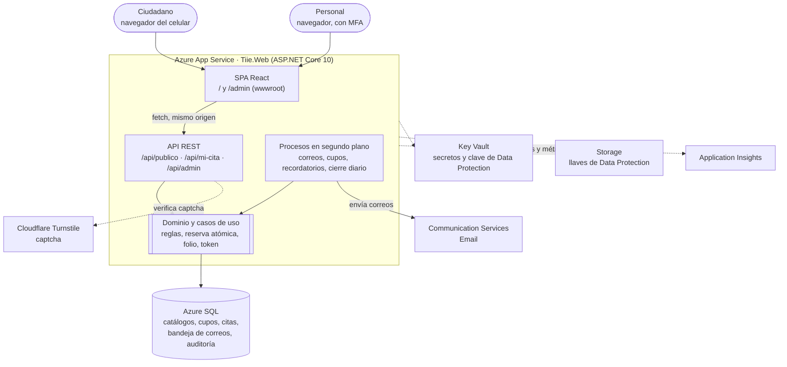
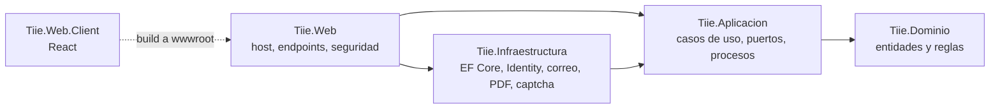
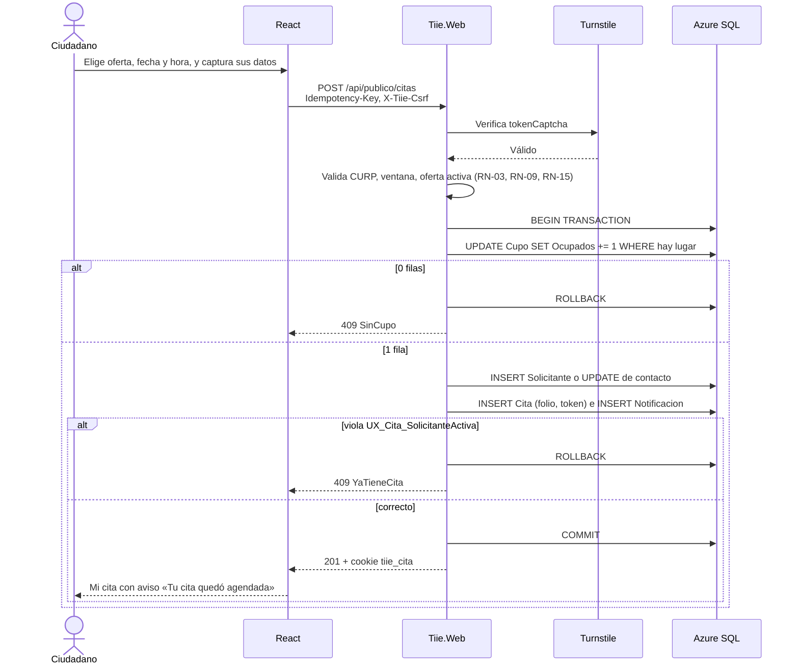
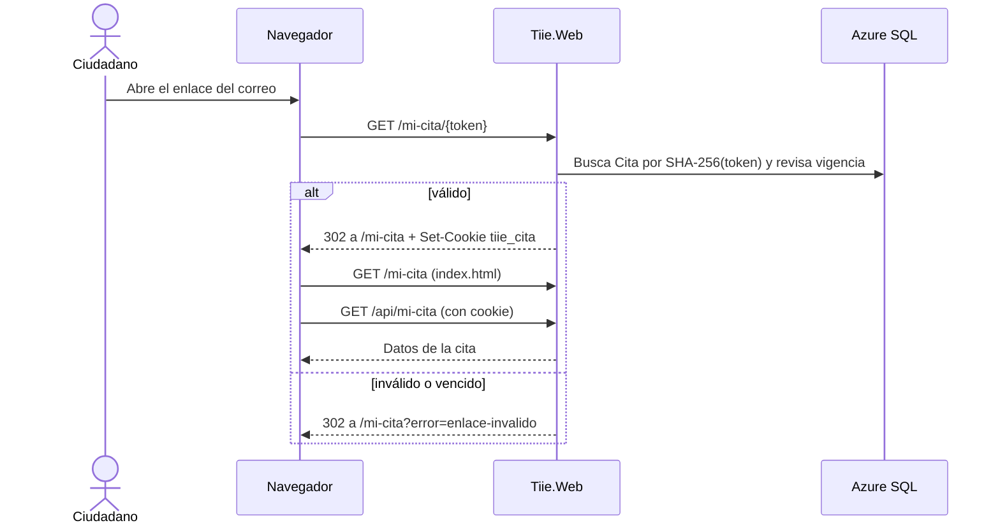

# 04 · Arquitectura

Un solo sitio ASP.NET Core 10 sirve la aplicación React, la API y los procesos en segundo plano. Público y personal usan el mismo dominio, así que no hay CORS y las cookies son de primera parte. Todas las reglas viven en el dominio de agenda, del lado del servidor.

## Vista general



## Un solo sitio

`Tiie.Web` publica los archivos que genera Vite en `wwwroot` y resuelve las rutas en este orden:

| Ruta | La atiende | Notas |
| --- | --- | --- |
| `/assets/*`, `/favicon.ico` y demás archivos | `MapStaticAssets` | Archivos con huella en el nombre; caché de un año |
| `/api/publico/*` | Endpoints públicos | Anónimos; límites por IP |
| `/api/mi-cita/*` | Endpoints del ciudadano | Cookie `tiie_cita` |
| `/api/admin/*` | Endpoints del personal | Cookie `tiie_sesion`, MFA y rol |
| `/api/*` no definida | 404 en JSON | Nunca devuelve `index.html` |
| `/mi-cita/{token}` | Endpoint del servidor | Cambia el token por la cookie y redirige a `/mi-cita` |
| `/salud` | Health checks | Usado por App Service y el cambio de ranuras |
| `/openapi/v1.json` | OpenAPI | Solo en Development |
| Cualquier otra ruta | `index.html` | React Router decide la pantalla; sin caché |

```csharp
var builder = WebApplication.CreateBuilder(args);

builder.AgregarObservabilidad();                                   // OpenTelemetry → Azure Monitor
builder.Services.AgregarInfraestructura(builder.Configuration);   // DbContext, Identity stores, correo, PDF, captcha
builder.Services.AgregarAplicacion(builder.Configuration);        // casos de uso, RelojAgenda, procesos
builder.Services.AgregarSeguridad(builder.Configuration);         // Identity, cookies, políticas, Data Protection
builder.Services.AgregarLimitesDeSolicitudes();
builder.Services.AddProblemDetails();
builder.Services.AddExceptionHandler<ManejadorExcepciones>();
builder.Services.AddOpenApi();
builder.Services.AddHealthChecks().AddDbContextCheck<TiieDbContext>();

var app = builder.Build();

app.UseForwardedHeaders();
app.UseExceptionHandler();
app.UseHsts();
app.UseHttpsRedirection();
app.UseCabecerasDeSeguridad();      // CSP, nosniff, Referrer-Policy, Permissions-Policy
app.UseAuthentication();
app.UseAuthorization();
app.UseRateLimiter();

app.MapStaticAssets();
app.MapEndpointsPublicos();         // /api/publico
app.MapEndpointsMiCita();           // /mi-cita/{token} y /api/mi-cita
app.MapEndpointsAdmin();            // /api/admin
app.MapHealthChecks("/salud");
if (app.Environment.IsDevelopment()) app.MapOpenApi();

app.Map("/api/{**resto}", () => Results.Problem(statusCode: 404));
app.MapFallbackToFile("index.html");

app.Run();
```

El detalle de cada extensión `Agregar…` está en [09-backend.md](09-backend.md). La integración con Vite (compilación y proxy de desarrollo) está en [08-frontend.md](08-frontend.md#compilación-e-integración-con-aspnet-core).

## Proyectos y dependencias



| Proyecto | Responsabilidad | Puede depender de |
| --- | --- | --- |
| `Tiie.Dominio` | Entidades, enums, reglas puras (`Curp`, `ReglasAgenda`, `CalculadoraDisponibilidad`), excepciones de negocio | Nada |
| `Tiie.Aplicacion` | Casos de uso, validadores, puertos (`ITiieDb`, `ICorreo`, `IGeneradorPdf`, `ICaptcha`), `RelojAgenda`, procesos programados | `Tiie.Dominio`, EF Core (abstracciones), FluentValidation |
| `Tiie.Infraestructura` | `TiieDbContext`, configuraciones, migraciones, Identity stores, adaptadores de correo, PDF, Excel y captcha | `Tiie.Aplicacion` |
| `Tiie.Web` | `Program.cs`, endpoints, autenticación, políticas, cabeceras, límites, OpenAPI, archivos de la SPA | `Tiie.Aplicacion`, `Tiie.Infraestructura` |
| `Tiie.Web.Client` | Interfaz pública y `/admin` | Solo la API HTTP |

Una prueba de arquitectura en `Tiie.Aplicacion.Tests` falla si `Tiie.Dominio` referencia otro ensamblado o si `Tiie.Aplicacion` referencia `Tiie.Infraestructura` o `Tiie.Web`.

## Flujo de una reserva



El correo no se envía dentro de la petición: queda en la tabla `Notificacion` y lo envía un proceso en segundo plano. Así un fallo del proveedor nunca revierte ni oculta una reserva.

## Acceso del ciudadano a su cita



## Procesos en segundo plano

Los procesos corren como `BackgroundService` dentro de `Tiie.Web` ([ADR 0007](adr/0007-outbox-y-procesos-en-el-sitio.md)). Si el sitio escala a varias instancias, ningún proceso se ejecuta dos veces:

- El envío de correos toma lotes con `UPDATE … WITH (READPAST, UPDLOCK)` y un tiempo de reserva.
- Los procesos diarios toman un candado `sp_getapplock` por nombre; la instancia que no lo obtiene no hace nada.

El detalle está en [10-notificaciones-y-procesos.md](10-notificaciones-y-procesos.md).

## Configuración

| Sección | Claves principales | Origen en Azure |
| --- | --- | --- |
| `ConnectionStrings:Tiie` | Cadena con `Authentication=Active Directory Default`, sin contraseña | Configuración de App Service |
| `Agenda` | Ver [03](03-reglas-de-negocio.md#parámetros) | `appsettings.json` |
| `Sitio` | `UrlPublica`, `VersionAvisoPrivacidad` | Configuración de App Service |
| `Correo` | `Proveedor` (`Archivo` o `Acs`), `Remitente`, `NombreRemitente`, `AcsEndpoint` | Configuración de App Service |
| `Captcha` | `ClaveSitio`, `ClaveSecreta` | `ClaveSecreta` como referencia a Key Vault |
| `Limites` | Una subsección por política: `Permitidas`, `VentanaMinutos` ([11](11-seguridad-y-privacidad.md#límites-de-solicitudes)) | `appsettings.json`; se sobrescribe en App Service si hace falta |
| `DataProtection` | `BlobUri`, `KeyUri` | Configuración de App Service |
| `Semilla` | `CorreoAdministrador`, `ContrasenaAdministrador` | Solo Development, con `dotnet user-secrets` |
| `APPLICATIONINSIGHTS_CONNECTION_STRING` | — | Configuración de App Service |

Cada sección se enlaza a una clase `Opciones…` con `ValidateDataAnnotations()` y `ValidateOnStart()`: el sitio no arranca con configuración incompleta.

## Entornos

| Entorno | Para qué | Datos | Correo | Captcha |
| --- | --- | --- | --- | --- |
| Desarrollo | Cada persona en su equipo | Semilla de ejemplo | Archivos `.eml` | Claves de prueba de Turnstile |
| Pruebas (QA) | Integración continua, E2E y aceptación | Semilla más migración de ensayo | Communication Services con lista de destinatarios permitidos | Claves de prueba |
| Producción | Público | Reales | Communication Services | Claves reales |

## Escalabilidad

Una instancia basta para empezar. Para escalar horizontalmente ya está resuelto lo necesario: llaves de Data Protection compartidas en Storage, procesos con candados en SQL y ningún estado en memoria salvo los límites de solicitudes, que se vuelven por instancia. Si la temporada lo exige, el siguiente paso es Azure Front Door con WAF delante del sitio.
