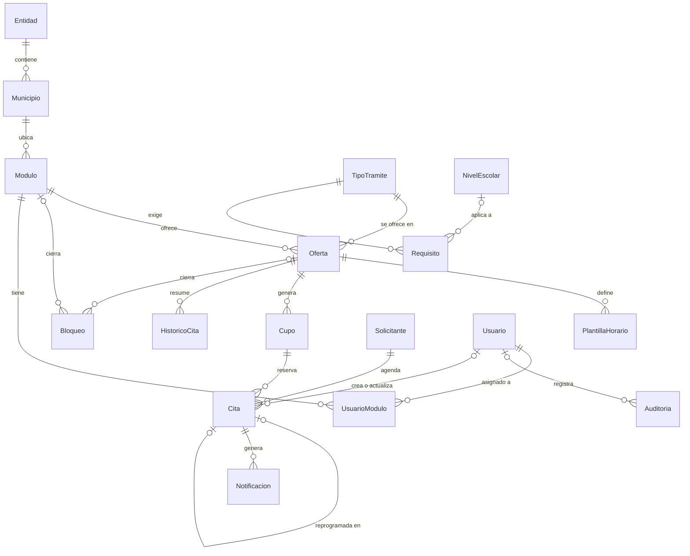

# 05 · Modelo de datos

17 tablas propias más las de Identity, con llave foránea en cada relación. La pieza central es `Cupo`: una fila por oferta, fecha y hora con su capacidad, que hace imposible la sobreventa ([ADR 0004](adr/0004-cupo-materializado.md)). El esquema se crea solo con migraciones de EF Core.

## Diagrama



## Convenciones

- Esquema `dbo`. Nombres de tabla en singular y en español, iguales a la entidad de C#.
- Llave primaria `<Tabla>Id`: `int IDENTITY`, salvo catálogos con IDs heredados (`Entidad`, `Municipio`, `NivelEscolar`) y tablas de alto volumen (`Notificacion`, `Auditoria`: `bigint`).
- Texto en `nvarchar`; códigos fijos en `char` o `varchar` (CURP, código postal, folio).
- Fechas `date`, horas `time(0)`, instantes `datetimeoffset(0)` en UTC.
- Enums como `tinyint` con restricción `CHECK`.
- `CreadoEn` y `ModificadoEn` los llena un interceptor de EF Core con `TimeProvider`.
- `RowVersion rowversion` en las tablas que edita el personal; un conflicto se responde con 409 `Conflicto`.
- Llaves foráneas con `ON DELETE NO ACTION`, salvo filas de configuración hijas (`Requisito`, `PlantillaHorario`, `UsuarioModulo`), que usan `CASCADE`.
- Baja lógica con `Activo`: nunca se borra lo que tiene historia (RN-11).

## Tablas

### Catálogos

**Entidad**

| Columna | Tipo | Nulo | Notas |
| --- | --- | --- | --- |
| `EntidadId` | `tinyint` | No | PK; mismo ID que el sistema anterior (25 = Sinaloa) |
| `Nombre` | `nvarchar(60)` | No | |
| `Activo` | `bit` | No | |

**Municipio**

| Columna | Tipo | Nulo | Notas |
| --- | --- | --- | --- |
| `MunicipioId` | `smallint` | No | PK; mismo ID que el sistema anterior |
| `EntidadId` | `tinyint` | No | FK → `Entidad` |
| `Nombre` | `nvarchar(100)` | No | |
| `Activo` | `bit` | No | |

**NivelEscolar**

| Columna | Tipo | Nulo | Notas |
| --- | --- | --- | --- |
| `NivelEscolarId` | `tinyint` | No | PK |
| `Nombre` | `nvarchar(80)` | No | |
| `Orden` | `tinyint` | No | Orden de presentación |

**Modulo**

| Columna | Tipo | Nulo | Notas |
| --- | --- | --- | --- |
| `ModuloId` | `int` | No | PK identity |
| `MunicipioId` | `smallint` | No | FK → `Municipio` |
| `Nombre` | `nvarchar(120)` | No | |
| `Calle` | `nvarchar(100)` | No | |
| `NumeroExterior` | `nvarchar(15)` | No | «S/N» si no tiene |
| `NumeroInterior` | `nvarchar(15)` | Sí | |
| `Colonia` | `nvarchar(80)` | No | |
| `CodigoPostal` | `char(5)` | No | |
| `Localidad` | `nvarchar(80)` | Sí | |
| `Telefono` | `varchar(10)` | Sí | |
| `Correo` | `nvarchar(150)` | Sí | |
| `HorarioAtencion` | `nvarchar(255)` | Sí | Texto informativo |
| `Latitud`, `Longitud` | `decimal(9,6)` | Sí | Para el enlace «Cómo llegar» |
| `Activo` | `bit` | No | |
| `IdAnterior` | `int` | Sí | `Modulo.ModuloId` del sistema anterior |
| `CreadoEn`, `ModificadoEn` | `datetimeoffset(0)` | No / Sí | |
| `RowVersion` | `rowversion` | No | |

**TipoTramite**

| Columna | Tipo | Nulo | Notas |
| --- | --- | --- | --- |
| `TipoTramiteId` | `int` | No | PK identity |
| `Nombre` | `nvarchar(120)` | No | Único |
| `Descripcion` | `nvarchar(500)` | Sí | |
| `Costo` | `decimal(10,2)` | Sí | Solo informativo |
| `Notas` | `nvarchar(max)` | Sí | Se imprimen en el comprobante |
| `Activo` | `bit` | No | |
| `CreadoEn`, `ModificadoEn`, `RowVersion` | | | |

**Requisito**

| Columna | Tipo | Nulo | Notas |
| --- | --- | --- | --- |
| `RequisitoId` | `int` | No | PK identity |
| `TipoTramiteId` | `int` | No | FK → `TipoTramite`, cascada |
| `NivelEscolarId` | `tinyint` | Sí | FK → `NivelEscolar`; vacío = aplica a todos los niveles |
| `Texto` | `nvarchar(max)` | No | Texto plano; los saltos de línea se respetan |
| `Orden` | `smallint` | No | |

**Oferta**

| Columna | Tipo | Nulo | Notas |
| --- | --- | --- | --- |
| `OfertaId` | `int` | No | PK identity |
| `ModuloId` | `int` | No | FK → `Modulo` |
| `TipoTramiteId` | `int` | No | FK → `TipoTramite` |
| `DiasVentana` | `smallint` | No | `CHECK (DiasVentana BETWEEN 1 AND 120)`; 49 por omisión |
| `NotasSede` | `nvarchar(max)` | Sí | Indicaciones propias de esta sede |
| `Activo` | `bit` | No | |
| `IdAnterior` | `int` | Sí | `Tramite.TramiteId` del sistema anterior |
| `CreadoEn`, `ModificadoEn`, `RowVersion` | | | |

Índice único `UX_Oferta_ModuloTipo (ModuloId, TipoTramiteId)`.

### Agenda

**PlantillaHorario**

| Columna | Tipo | Nulo | Notas |
| --- | --- | --- | --- |
| `PlantillaHorarioId` | `int` | No | PK identity |
| `OfertaId` | `int` | No | FK → `Oferta`, cascada |
| `DiaSemana` | `tinyint` | No | `CHECK (DiaSemana BETWEEN 0 AND 6)`; 0 = domingo |
| `Hora` | `time(0)` | No | |
| `Turnos` | `tinyint` | No | `CHECK (Turnos > 0)` |

Índice único `UX_Plantilla_OfertaDiaHora (OfertaId, DiaSemana, Hora)`.

**Bloqueo**

| Columna | Tipo | Nulo | Notas |
| --- | --- | --- | --- |
| `BloqueoId` | `int` | No | PK identity |
| `Desde`, `Hasta` | `date` | No | Inclusivos; `CHECK (Desde <= Hasta)` |
| `ModuloId` | `int` | Sí | FK → `Modulo` |
| `OfertaId` | `int` | Sí | FK → `Oferta`; `CHECK (ModuloId IS NULL OR OfertaId IS NULL)` |
| `Motivo` | `nvarchar(200)` | No | Se muestra al ciudadano como «Cerrado: motivo» |
| `CreadoPor` | `int` | No | FK → `Usuario` |
| `CreadoEn` | `datetimeoffset(0)` | No | |

Índice `IX_Bloqueo_Rango (Desde, Hasta)`. Sin módulo ni oferta, el bloqueo es general (día inhábil).

**Cupo**

| Columna | Tipo | Nulo | Notas |
| --- | --- | --- | --- |
| `CupoId` | `int` | No | PK identity |
| `OfertaId` | `int` | No | FK → `Oferta` |
| `Fecha` | `date` | No | |
| `Hora` | `time(0)` | No | |
| `Capacidad` | `smallint` | No | `CHECK (Capacidad > 0)` |
| `Ocupados` | `smallint` | No | 0 por omisión; `CHECK (Ocupados BETWEEN 0 AND Capacidad)` |
| `Cerrado` | `bit` | No | 0 por omisión; lo pone un bloqueo o el generador |
| `RowVersion` | `rowversion` | No | |

Índices: único `UX_Cupo_OfertaFechaHora (OfertaId, Fecha, Hora) INCLUDE (Capacidad, Ocupados, Cerrado)` para disponibilidad, e `IX_Cupo_Fecha (Fecha) INCLUDE (OfertaId, Hora)` para el cierre diario y los recordatorios.

**HistoricoCita**

Totales diarios del sistema anterior, sin datos personales ([14](14-migracion-de-datos.md)).

| Columna | Tipo | Nulo | Notas |
| --- | --- | --- | --- |
| `Fecha` | `date` | No | PK compuesta |
| `OfertaId` | `int` | No | PK compuesta; FK → `Oferta` |
| `Total` | `int` | No | |

### Citas

**Solicitante**

| Columna | Tipo | Nulo | Notas |
| --- | --- | --- | --- |
| `SolicitanteId` | `int` | No | PK identity |
| `Curp` | `char(18)` | Sí | Único filtrado `UX_Solicitante_Curp` (`WHERE Curp IS NOT NULL`); vacío solo tras anonimizar |
| `Nombre` | `nvarchar(80)` | No | |
| `ApellidoPaterno` | `nvarchar(80)` | No | |
| `ApellidoMaterno` | `nvarchar(80)` | Sí | |
| `FechaNacimiento` | `date` | Sí | Derivada de la CURP |
| `Sexo` | `char(1)` | Sí | `CHECK (Sexo IN ('H','M','X'))`; derivado de la CURP |
| `Celular` | `varchar(10)` | Sí | Obligatorio en la reserva pública |
| `Correo` | `nvarchar(150)` | Sí | Obligatorio en la reserva pública; opcional en ventanilla |
| `CreadoEn`, `ModificadoEn` | `datetimeoffset(0)` | | |
| `AnonimizadoEn` | `datetimeoffset(0)` | Sí | |

**Cita**

| Columna | Tipo | Nulo | Notas |
| --- | --- | --- | --- |
| `CitaId` | `int` | No | PK identity |
| `Folio` | `varchar(14)` | No | Único; RN-10 |
| `CupoId` | `int` | No | FK → `Cupo` |
| `SolicitanteId` | `int` | No | FK → `Solicitante` |
| `Estado` | `tinyint` | No | 1 Agendada, 2 Atendida, 3 No asistió, 4 Cancelada, 5 Reprogramada |
| `Origen` | `tinyint` | No | 1 Web, 2 Ventanilla, 3 Migración |
| `TokenHash` | `binary(32)` | No | Único; SHA-256 del token |
| `TokenProtegido` | `varchar(600)` | No | Token cifrado con Data Protection; Base64url, solo ASCII (176 caracteres hoy) |
| `TokenVenceEn` | `datetimeoffset(0)` | No | RN-16 |
| `ClaveIdempotencia` | `uniqueidentifier` | Sí | Único filtrado `UX_Cita_ClaveIdempotencia` (`WHERE ClaveIdempotencia IS NOT NULL`) |
| `VersionAvisoPrivacidad` | `varchar(20)` | Sí | Versión aceptada |
| `AvisoAceptadoEn` | `datetimeoffset(0)` | Sí | |
| `CitaOrigenId` | `int` | Sí | FK → `Cita`; la cita que se reprogramó |
| `MotivoCambio` | `nvarchar(300)` | Sí | Motivo de cancelación o reprogramación |
| `FolioAnterior` | `varchar(20)` | Sí | Folio del sistema de 2016 |
| `CreadaEn` | `datetimeoffset(0)` | No | |
| `CreadaPor` | `int` | Sí | FK → `Usuario`; vacío si la creó el ciudadano |
| `ActualizadaEn` | `datetimeoffset(0)` | Sí | |
| `ActualizadaPor` | `int` | Sí | FK → `Usuario`; vacío si fue el ciudadano o el sistema |
| `RowVersion` | `rowversion` | No | |

Índices:

- Únicos `UX_Cita_Folio (Folio)`, `UX_Cita_TokenHash (TokenHash)` y `UX_Cita_ClaveIdempotencia (ClaveIdempotencia) WHERE ClaveIdempotencia IS NOT NULL`.
- `UX_Cita_SolicitanteActiva (SolicitanteId) WHERE Estado = 1` — RN-01.
- `IX_Cita_Solicitante (SolicitanteId, Estado)` — búsqueda por CURP y retención.
- `IX_Cita_Cupo (CupoId) INCLUDE (Estado, SolicitanteId, Folio, Origen)` — agenda del día, listados, tablero y reportes sin volver a la tabla.
- `IX_Cita_FolioAnterior (FolioAnterior) WHERE FolioAnterior IS NOT NULL` — búsqueda del personal.
- `IX_Cita_CitaOrigen`, `IX_Cita_CreadaPor` e `IX_Cita_ActualizadaPor`, de las llaves foráneas, filtrados con `IS NOT NULL` porque casi siempre están vacías.

La búsqueda del personal por folio, folio anterior o CURP se resuelve con tres búsquedas exactas unidas, nunca con un `OR` entre `Cita` y `Solicitante`, que recorrería todas las citas ([18](18-analisis-de-base-de-datos.md)).

**Notificacion**

| Columna | Tipo | Nulo | Notas |
| --- | --- | --- | --- |
| `NotificacionId` | `bigint` | No | PK identity |
| `CitaId` | `int` | No | FK → `Cita` |
| `Tipo` | `tinyint` | No | 1 Confirmación, 2 Recordatorio, 3 Cancelación, 4 Reprogramación, 5 Enlace de recuperación, 6 Cierre por bloqueo, 7 Aviso de migración |
| `Canal` | `tinyint` | No | 1 Correo |
| `Destinatario` | `nvarchar(150)` | No | |
| `Estado` | `tinyint` | No | 1 Pendiente, 2 Enviada, 3 Fallida (se reintenta), 4 Descartada |
| `Intentos` | `tinyint` | No | |
| `ProximoIntentoEn` | `datetimeoffset(0)` | No | |
| `EnviadaEn` | `datetimeoffset(0)` | Sí | |
| `UltimoError` | `nvarchar(1000)` | Sí | Sin datos personales |
| `CreadaEn` | `datetimeoffset(0)` | No | |

Índices: `IX_Notificacion_Pendientes (ProximoIntentoEn) WHERE Estado IN (1, 3)` y único `UX_Notificacion_Recordatorio (CitaId, Tipo) WHERE Tipo = 2` (RN-14).

### Personal y auditoría

Las tablas de Identity se renombran en `OnModelCreating`: `Usuario`, `Rol`, `UsuarioRol`, `UsuarioClaim`, `UsuarioLogin`, `UsuarioToken` y `RolClaim`. `Usuario` hereda de `IdentityUser<int>` y agrega:

| Columna | Tipo | Nulo | Notas |
| --- | --- | --- | --- |
| `Nombre` | `nvarchar(80)` | No | |
| `ApellidoPaterno` | `nvarchar(80)` | No | |
| `ApellidoMaterno` | `nvarchar(80)` | Sí | |
| `Activo` | `bit` | No | Un usuario inactivo no puede iniciar sesión |
| `CreadoEn` | `datetimeoffset(0)` | No | |
| `UltimoAccesoEn` | `datetimeoffset(0)` | Sí | |

`UserName` y `NormalizedEmail` son únicos (Identity ya crea esos índices).

**UsuarioModulo**: `UsuarioId` (FK → `Usuario`, cascada) y `ModuloId` (FK → `Modulo`), con PK compuesta. Los administradores no necesitan filas aquí: ven todos los módulos.

**Auditoria**

| Columna | Tipo | Nulo | Notas |
| --- | --- | --- | --- |
| `AuditoriaId` | `bigint` | No | PK identity |
| `Fecha` | `datetimeoffset(0)` | No | |
| `UsuarioId` | `int` | Sí | FK → `Usuario`; vacío para el sistema o un intento anónimo |
| `Accion` | `varchar(60)` | No | Por ejemplo `Cita.Cancelar`, `Sesion.Iniciar`, `Plantilla.Guardar` |
| `Entidad` | `varchar(60)` | No | |
| `EntidadId` | `varchar(40)` | Sí | |
| `Cambios` | `nvarchar(max)` | Sí | JSON con valores anteriores y nuevos, datos personales enmascarados |
| `Ip` | `varchar(45)` | Sí | |

Índices `IX_Auditoria_Fecha (Fecha)`, `IX_Auditoria_Usuario (UsuarioId, Fecha)` e `IX_Auditoria_Entidad (Entidad, EntidadId)`, para los movimientos del detalle de una cita. El usuario de base de datos de la aplicación solo tiene `INSERT` y `SELECT` sobre esta tabla.

**EjecucionProceso**

| Columna | Tipo | Nulo | Notas |
| --- | --- | --- | --- |
| `Nombre` | `varchar(60)` | No | PK; nombre del proceso |
| `UltimoInicio` | `datetimeoffset(0)` | Sí | |
| `UltimoFin` | `datetimeoffset(0)` | Sí | |
| `UltimoResultado` | `varchar(20)` | Sí | `Correcto` o `Error` |
| `Detalle` | `nvarchar(1000)` | Sí | Resumen, sin datos personales |

## Secuencia

```sql
CREATE SEQUENCE dbo.SecuenciaFolio AS bigint START WITH 1000000 INCREMENT BY 1 NO CYCLE;
```

Se declara en el modelo con `HasSequence<long>("SecuenciaFolio").StartsAt(1_000_000)`, así la crea la migración y `has-pending-model-changes` la vigila. Se lee sin componer la consulta, porque SQL Server no admite `NEXT VALUE FOR` dentro de una subconsulta y `SingleAsync` la envolvería en una:

```csharp
var siguiente = (await db.Database
    .SqlQuery<long>($"SELECT NEXT VALUE FOR dbo.SecuenciaFolio AS Value")
    .ToListAsync(ct)).Single();
```

## Datos semilla

| Tabla | Contenido | Entornos |
| --- | --- | --- |
| `Rol` | Administrador, Supervisor, Capturista | Todos (migración) |
| `NivelEscolar` | 1 «Básico (preescolar, primaria y secundaria)», 2 «Medio superior y superior» | Todos (migración) |
| `Entidad`, `Municipio` | Entidad 25 y sus municipios | Desarrollo y QA por semilla; producción por migración de datos |
| `TipoTramite` y `Requisito` | Primera vez, Sustitución y Reactivación con requisitos de ejemplo | Solo desarrollo y QA |
| `Modulo`, `Oferta`, `PlantillaHorario` | Dos módulos de ejemplo con plantillas de lunes a sábado | Solo desarrollo y QA |
| `Usuario` | Un administrador con la contraseña de `Semilla:ContrasenaAdministrador` | Solo desarrollo |

Los datos de ejemplo se cargan con `ISembradorDesarrollo` al arrancar en Development o QA; nunca en producción.

## Notas para EF Core

- Una clase `IEntityTypeConfiguration<T>` por entidad en `Tiie.Infraestructura/Datos/Configuraciones/`.
- `DateOnly` y `TimeOnly` se mapean de forma nativa a `date` y `time`; se fija la precisión `time(0)` y `datetimeoffset(0)` en `ConfigureConventions`.
- Los índices filtrados y las restricciones `CHECK` se declaran con `HasFilter(...)` y `ToTable(t => t.HasCheckConstraint(...))`.
- Las enumeraciones se guardan como `tinyint` con `HasConversion<byte>()`.
- Las lecturas usan `AsNoTracking()` y proyecciones a DTO; nunca se devuelve una entidad desde un endpoint.
