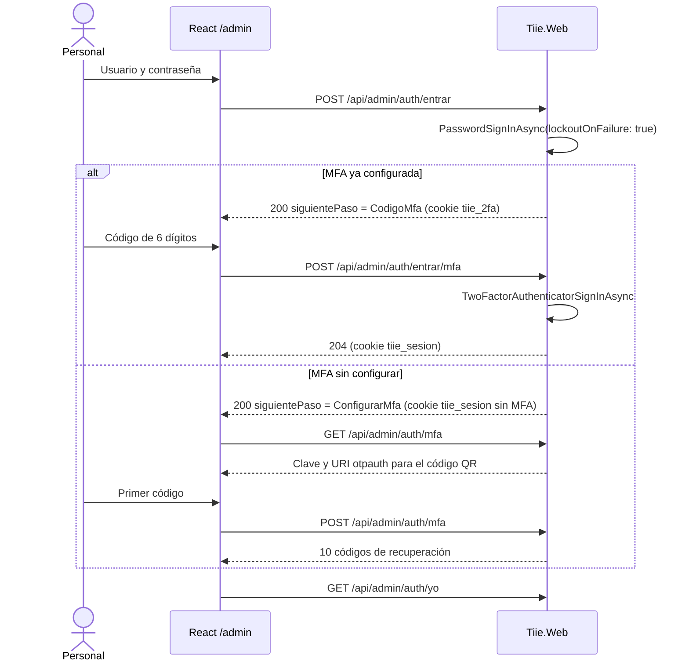

# 07 · Autenticación y autorización

El personal entra con ASP.NET Core Identity: cookie de sesión, contraseña y MFA obligatoria con una app autenticadora. El ciudadano no tiene cuenta: cambia el token de su correo por una cookie que solo da acceso a su cita. Las decisiones están en los [ADR 0003](adr/0003-aspnet-core-identity-con-cookies-y-mfa.md) y [0005](adr/0005-acceso-ciudadano-por-token.md).

## Esquemas y cookies

| Cookie | Esquema | Para qué | Ruta | Duración |
| --- | --- | --- | --- | --- |
| `tiie_sesion` | `Identity.Application` | Sesión del personal | `/` | 30 min de inactividad; máximo 10 h |
| `tiie_2fa` | `Identity.TwoFactorUserId` | Paso intermedio entre contraseña y código | `/` | 5 min |
| `tiie_equipo` | `Identity.TwoFactorRememberMe` | «Recordar este equipo» para el código MFA | `/` | 14 días |
| `tiie_cita` | `Cita` | Acceso del ciudadano a una cita | `/api/mi-cita` | 30 min de inactividad |

Todas son `HttpOnly`, `Secure` y `SameSite=Lax`.

## Configuración de Identity

```csharp
services
    .AddIdentityCore<Usuario>(o =>
    {
        o.User.RequireUniqueEmail = true;
        o.SignIn.RequireConfirmedEmail = true;
        o.Password.RequiredLength = 12;
        o.Password.RequireDigit = false;
        o.Password.RequireLowercase = false;
        o.Password.RequireUppercase = false;
        o.Password.RequireNonAlphanumeric = false;
        o.Lockout.AllowedForNewUsers = true;
        o.Lockout.MaxFailedAccessAttempts = 5;
        o.Lockout.DefaultLockoutTimeSpan = TimeSpan.FromMinutes(15);
    })
    .AddRoles<Rol>()
    .AddEntityFrameworkStores<TiieDbContext>()
    .AddSignInManager()
    .AddDefaultTokenProviders()
    .AddClaimsPrincipalFactory<FabricaClaimsUsuario>()
    .AddPasswordValidator<ValidadorContrasenasComunes>();

services.Configure<PasswordHasherOptions>(o => o.IterationCount = 210_000);
services.Configure<SecurityStampValidatorOptions>(o => o.ValidationInterval = TimeSpan.FromMinutes(5));
services.Configure<DataProtectionTokenProviderOptions>(o => o.TokenLifespan = TimeSpan.FromHours(24));

services.AddAuthentication(IdentityConstants.ApplicationScheme)
    .AddCookie(EsquemasTiie.Cita, ConfigurarCookieCita)
    .AddIdentityCookies();
```

- La contraseña pide 12 caracteres o más, sin reglas de composición, y se rechaza si está en la lista de contraseñas frecuentes (`ValidadorContrasenasComunes`, con una lista de 10 000 incluida como recurso).
- No se usa `MapIdentityApi`: expone registro público y tokens bearer, y aquí las cuentas solo las crea un administrador.
- `Usuario.Activo = false` bloquea el acceso: `FabricaClaimsUsuario` y el validador de sesión lo revisan.

## Cookie de sesión del personal

```csharp
services.ConfigureApplicationCookie(o =>
{
    o.Cookie.Name = "tiie_sesion";
    o.Cookie.HttpOnly = true;
    o.Cookie.SecurePolicy = CookieSecurePolicy.Always;
    o.Cookie.SameSite = SameSiteMode.Lax;
    o.ExpireTimeSpan = TimeSpan.FromMinutes(30);
    o.SlidingExpiration = true;

    // Una SPA no sigue redirecciones de login: responder con el código.
    o.Events.OnRedirectToLogin = c => { c.Response.StatusCode = 401; return Task.CompletedTask; };
    o.Events.OnRedirectToAccessDenied = c => { c.Response.StatusCode = 403; return Task.CompletedTask; };

    // Marca el inicio real de la sesión; la renovación por inactividad conserva este valor.
    o.Events.OnSigningIn = c =>
    {
        c.Properties.Items.TryAdd(".tiie.inicio", c.HttpContext.RequestServices
            .GetRequiredService<TimeProvider>().GetUtcNow().ToString("O"));
        return Task.CompletedTask;
    };

    // Identity ya valida el sello de seguridad aquí: se encadena, no se reemplaza.
    o.Events.OnValidatePrincipal = async c =>
    {
        await SecurityStampValidator.ValidatePrincipalAsync(c);
        if (c.Principal is not null) ValidadorSesion.ExigirDuracionMaxima(c, TimeSpan.FromHours(10));
    };
});
```

Desactivar un usuario, cambiar su rol, sus módulos o restablecer su MFA llama a `UserManager.UpdateSecurityStampAsync`: sus sesiones dejan de valer en menos de 5 minutos.

## Inicio de sesión



- `PasswordSignInAsync` devuelve `RequiresTwoFactor` si el usuario tiene MFA activa; en ese caso la sesión todavía no existe.
- Sin MFA configurada, la sesión existe pero solo sirve para las rutas de política `PersonalSinMfa`: `yo`, `mfa`, `salir`. Todo lo demás responde 403 `MfaRequerido`.
- `POST /api/admin/auth/mfa` verifica el código con `VerifyTwoFactorTokenAsync`, activa MFA, genera los códigos de recuperación y llama a `RefreshSignInAsync` para que la cookie ya traiga `mfa = true`.
- La URI del autenticador es `otpauth://totp/TIIE:{correo}?secret={clave}&issuer=TIIE&digits=6`. La SPA dibuja el QR localmente; la clave nunca se envía a un servicio externo.
- Cada inicio y cierre de sesión, intento fallido, bloqueo, configuración o restablecimiento de MFA se registra en `Auditoria`.

## Activación y restablecimiento

1. El administrador crea el usuario sin contraseña.
2. Se envía un correo con `{UrlPublica}/admin/activar?usuarioId={id}&token={token}`, donde `token` viene de `GeneratePasswordResetTokenAsync` y vence en 24 horas.
3. `POST /api/admin/auth/activacion` llama a `ResetPasswordAsync`, marca `EmailConfirmed = true` y no inicia sesión.
4. En el primer inicio se configura MFA.

El restablecimiento usa el mismo mecanismo con la ruta `/admin/restablecer`. `olvide-contrasena` responde 202 siempre, exista o no el correo, e incluso si el envío falla: un 503 revelaría que la cuenta existe. Los correos al personal se envían en el momento (no por la bandeja de salida); en la invitación que envía un administrador, un fallo responde 503 `CorreoNoDisponible` y puede reenviarla.

## Roles y políticas

| Política | Requisitos | Uso |
| --- | --- | --- |
| `PersonalSinMfa` | Sesión del personal | `yo`, configuración de MFA, `salir` |
| `Personal` | Sesión + claim `mfa = true` | Todo `/api/admin` salvo lo anterior |
| `Supervisor` | `Personal` + rol Administrador o Supervisor | Ofertas, plantillas, bloqueos, reportes, correcciones |
| `Administrador` | `Personal` + rol Administrador | Usuarios, módulos, tipos de trámite, días inhábiles, portada del sitio, auditoría |
| `Cita` | Esquema `Cita` + claim `cita_id` | `/api/mi-cita` |

```csharp
services.AddAuthorizationBuilder()
    .AddPolicy(Politicas.PersonalSinMfa, p => p
        .AddAuthenticationSchemes(IdentityConstants.ApplicationScheme)
        .RequireAuthenticatedUser())
    .AddPolicy(Politicas.Personal, p => p
        .AddAuthenticationSchemes(IdentityConstants.ApplicationScheme)
        .RequireAuthenticatedUser()
        .RequireClaim(ClaimsTiie.Mfa, "true"))
    .AddPolicy(Politicas.Supervisor, p => p
        .AddAuthenticationSchemes(IdentityConstants.ApplicationScheme)
        .RequireClaim(ClaimsTiie.Mfa, "true")
        .RequireRole(Roles.Administrador, Roles.Supervisor))
    .AddPolicy(Politicas.Administrador, p => p
        .AddAuthenticationSchemes(IdentityConstants.ApplicationScheme)
        .RequireClaim(ClaimsTiie.Mfa, "true")
        .RequireRole(Roles.Administrador))
    .AddPolicy(Politicas.Cita, p => p
        .AddAuthenticationSchemes(EsquemasTiie.Cita)
        .RequireClaim(ClaimsTiie.CitaId));
```

`FabricaClaimsUsuario` agrega `mfa` (según `TwoFactorEnabled`), `nombre_completo` y un claim `modulo` por cada módulo asignado.

### Matriz de permisos

| Permiso | Administrador | Supervisor | Capturista |
| --- | --- | --- | --- |
| Usuarios del personal | Sí | No | No |
| Módulos | Sí | Ver los suyos | Ver los suyos |
| Tipos de trámite y requisitos | Sí | Ver | Ver |
| Ofertas de un módulo | Sí | Sus módulos | Ver los suyos |
| Plantillas, cupos y bloqueos de módulo u oferta | Sí | Sus módulos | Ver los suyos |
| Días inhábiles generales | Sí | No | No |
| Agenda del día y asistencia | Sí | Sus módulos | Sus módulos |
| Registrar, cancelar y reprogramar citas | Sí | Sus módulos | Sus módulos |
| Corregir asistencia (7 días) | Sí | Sus módulos | No |
| Reportes | Sí | Sus módulos | No |
| Tablero | Sí | Sus módulos | Sus módulos |
| Bitácora de auditoría y procesos | Sí | No | No |
| Portada del sitio (encabezado, aviso y preguntas) | Sí | No | No |

## Alcance por módulo

```csharp
public interface IAutorizacionModulo
{
    /// null = todos los módulos (Administrador).
    IReadOnlySet<int>? ModulosPermitidos { get; }
    bool PuedeAcceder(int moduloId);
    /// Lanza NoEncontradoException: un recurso de otro módulo responde 404.
    void ExigirAcceso(int moduloId);
}
```

- Se implementa con los claims `modulo` de la sesión; no consulta la base en cada petición.
- Las listas filtran en la consulta: `.Where(c => permitidos == null || permitidos.Contains(c.Cupo.Oferta.ModuloId))`.
- Los casos de uso que reciben un ID (cita, cupo, oferta, bloqueo) cargan primero el `ModuloId` del recurso y llaman a `ExigirAcceso`.
- Una prueba de integración por endpoint confirma que un capturista del módulo A recibe 404 con un recurso del módulo B.

## Protección CSRF

La SPA y la API comparten origen y usan cookies, así que hay que impedir que otro sitio dispare peticiones con ellas. Se usan tres capas en lugar de los tokens de `IAntiforgery`, porque esos tokens se atan a la identidad del esquema por defecto y aquí conviven dos esquemas (personal y cita), lo que produce falsos rechazos.

1. **Cookies `SameSite=Lax`:** el navegador no las envía en `POST` iniciados desde otro sitio.
2. **Cabecera obligatoria `X-Tiie-Csrf: 1`** en `POST`, `PUT`, `PATCH` y `DELETE`. Un formulario de otro sitio no puede agregar cabeceras, y una petición `fetch` de otro origen con cabecera propia requiere CORS, que el sitio no habilita.
3. **Fetch Metadata:** si `Sec-Fetch-Site` viene y no es `same-origin` ni `none`, se rechaza. Si no viene y la petición trae `Origin`, debe ser igual a `Sitio:UrlPublica`. Los navegadores actuales siempre envían `Sec-Fetch-Site`; un cliente que no es navegador, como la prueba de humo, no lleva cookies de otro sitio y puede declarar `same-origin`.

```csharp
public sealed class FiltroCsrf(IOptions<OpcionesSitio> sitio) : IEndpointFilter
{
    public async ValueTask<object?> InvokeAsync(EndpointFilterInvocationContext ctx, EndpointFilterDelegate next)
    {
        var req = ctx.HttpContext.Request;
        if (HttpMethods.IsGet(req.Method) || HttpMethods.IsHead(req.Method)) return await next(ctx);

        if (req.Headers["X-Tiie-Csrf"] != "1")
            return ErroresApi.SolicitudInvalida("Falta la cabecera X-Tiie-Csrf.");

        var sitioOrigen = req.Headers["Sec-Fetch-Site"].ToString();
        if (sitioOrigen is not ("" or "same-origin" or "none"))
            return ErroresApi.Prohibido();

        if (sitioOrigen == "" && req.Headers.Origin is { Count: > 0 } origen
            && !string.Equals(origen, sitio.Value.UrlBase, StringComparison.OrdinalIgnoreCase))
            return ErroresApi.Prohibido();

        return await next(ctx);
    }
}
```

El filtro se aplica a los tres grupos de rutas. La SPA agrega la cabecera en todas sus peticiones ([08](08-frontend.md#cliente-de-la-api)).

## Acceso del ciudadano

### Emisión del token

```csharp
var bytes = RandomNumberGenerator.GetBytes(32);
var token = WebEncoders.Base64UrlEncode(bytes);                 // 43 caracteres
cita.TokenHash = SHA256.HashData(Encoding.ASCII.GetBytes(token));
cita.TokenProtegido = protector.Protect(token);                 // IDataProtector "Tiie.TokenCita.v1"
cita.TokenVenceEn = reloj.FinDelDia(cita.Fecha.AddDays(1));     // RN-16
```

El token en claro nunca se guarda ni se registra. El proceso de correos lo recupera con `protector.Unprotect(TokenProtegido)` solo para armar el enlace `{UrlPublica}/mi-cita/{token}`.

### Intercambio por la cookie

```csharp
app.MapGet("/mi-cita/{token}", async (string token, AccesoCita acceso, HttpContext http) =>
{
    http.Response.Headers.CacheControl = "no-store";
    http.Response.Headers["Referrer-Policy"] = "no-referrer";

    var cita = await acceso.BuscarVigenteAsync(token, http.RequestAborted);
    if (cita is null) return Results.Redirect("/mi-cita?error=enlace-invalido");

    await http.SignInAsync(EsquemasTiie.Cita, AccesoCita.CrearPrincipal(cita.CitaId, cita.TokenVenceEn));
    return Results.Redirect("/mi-cita");
}).RequireRateLimiting(Limites.EnlaceCita);
```

- `POST /api/publico/citas` también inicia esta sesión al crear la cita, para mostrar «Mi cita» sin esperar el correo.
- La cookie lleva `cita_id` y el vencimiento del token. En cada petición, `OnValidatePrincipal` confirma que el token sigue vigente; si venció, rechaza la cookie.
- Reprogramar reemplaza la cookie por una de la cita nueva.
- `POST /api/mi-cita/salida` cierra la sesión de la cita.

```csharp
static void ConfigurarCookieCita(CookieAuthenticationOptions o)
{
    o.Cookie.Name = "tiie_cita";
    o.Cookie.Path = "/api/mi-cita";
    o.Cookie.HttpOnly = true;
    o.Cookie.SecurePolicy = CookieSecurePolicy.Always;
    o.Cookie.SameSite = SameSiteMode.Lax;
    o.ExpireTimeSpan = TimeSpan.FromMinutes(30);
    o.SlidingExpiration = true;
    o.Events.OnRedirectToLogin = c => { c.Response.StatusCode = 401; return Task.CompletedTask; };
    o.Events.OnValidatePrincipal = ValidadorCita.ValidarAsync;
}
```

## Data Protection

Las cookies, los tokens de Identity y `TokenProtegido` dependen de las llaves de Data Protection. Se comparten entre instancias y ranuras de despliegue:

```csharp
services.AddDataProtection()
    .SetApplicationName("Tiie")
    .PersistKeysToAzureBlobStorage(new Uri(opciones.BlobUri), credencial)
    .ProtectKeysWithAzureKeyVault(new Uri(opciones.KeyUri), credencial);
```

`credencial` es `DefaultAzureCredential`, que en Azure usa la identidad administrada del sitio. En desarrollo, las llaves quedan en el perfil local del usuario. Perder las llaves invalida sesiones y los enlaces de los correos ya enviados, por eso el contenedor de Storage y la llave de Key Vault tienen bloqueo contra borrado.
