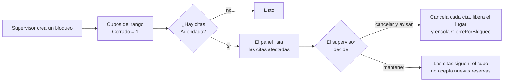

# 10 · Notificaciones y procesos

Los correos al ciudadano nunca se envían dentro de una petición: se guardan en la tabla `Notificacion` en la misma transacción que la cita, y un proceso los envía con reintentos. Los procesos programados corren dentro del mismo sitio y usan SQL para no ejecutarse dos veces ([ADR 0007](adr/0007-outbox-y-procesos-en-el-sitio.md)).

## Tipos de notificación

| Tipo | Valor | Se encola cuando | Asunto | Enlace a Mi cita | PDF adjunto |
| --- | --- | --- | --- | --- | --- |
| Confirmación | 1 | Se crea una cita con correo (web o ventanilla) | «Tu cita para la TIIE: {fecha} a las {hora}» | Sí | Sí |
| Recordatorio | 2 | 09:00 del día anterior (RN-14) | «Mañana es tu cita para la TIIE» | Sí | No |
| Cancelación | 3 | El ciudadano o el personal cancela | «Tu cita {folio} fue cancelada» | No; enlace para agendar de nuevo | No |
| Reprogramación | 4 | Se reprograma (RN-17) | «Tu cita cambió: {fecha} a las {hora}» | Sí, de la cita nueva | Sí |
| Enlace de recuperación | 5 | El ciudadano lo pide (RF-06) | «Enlace para consultar tu cita» | Sí | No |
| Cierre por bloqueo | 6 | El personal cancela citas afectadas por un bloqueo | «Tu cita fue cancelada por cierre del módulo» | No; enlace para agendar de nuevo | No |
| Aviso de migración | 7 | Migración de citas futuras ([14](14-migracion-de-datos.md)) | «Tu cita sigue vigente: este es tu nuevo enlace» | Sí | Sí |

Los correos al personal (invitación y restablecimiento de contraseña) no pasan por esta tabla: se envían en el momento ([07](07-autenticacion-y-autorizacion.md#activación-y-restablecimiento)).

## Plantillas

- Viven en `Tiie.Infraestructura/Correo/Plantillas/`: un `.html` y un `.txt` por tipo, más un diseño común.
- Los marcadores son `{{Folio}}`, `{{Fecha}}`, `{{Hora}}`, `{{Modulo}}`, `{{Direccion}}`, `{{Tramite}}`, `{{Requisitos}}`, `{{Enlace}}`, `{{Motivo}}`. Cada valor se codifica para HTML antes de insertarlo.
- Sin imágenes ni scripts de terceros; el logotipo se sirve desde el propio sitio.
- Las fechas se escriben largas y en español: «jueves 12 de noviembre de 2026, 10:30».
- El pie incluye el aviso de privacidad simplificado y aclara que el correo no recibe respuestas.

## Envío

- Proveedor en producción: Azure Communication Services Email, autenticado con la identidad administrada del sitio. Remitente de un dominio verificado con SPF y DKIM.
- En desarrollo, `CorreoArchivo` escribe archivos `.eml` en `artifacts/correos/`.
- En QA, `Correo:DestinatariosPermitidos` limita los envíos a una lista; los demás se marcan como enviados sin salir.
- El PDF adjunto se genera al momento del envío con los datos vigentes de la cita.
- El enlace se arma con `{Sitio:UrlPublica}/mi-cita/{token}`, recuperando el token con `IDataProtector.Unprotect(TokenProtegido)`.
- Antes de enviar una Confirmación o un Recordatorio se revisa que la cita siga Agendada; si no, la notificación queda Descartada sin enviarse.

## Proceso de envío

Cada 15 segundos, el proceso reserva un lote con una sola sentencia. `READPAST` salta filas que otra instancia ya tomó, así que dos instancias nunca envían el mismo correo:

```sql
UPDATE TOP (@lote) dbo.Notificacion WITH (READPAST, UPDLOCK, ROWLOCK)
SET ProximoIntentoEn = @reservadaHasta          -- ahora + 5 minutos
OUTPUT inserted.NotificacionId
WHERE Estado IN (1, 3) AND ProximoIntentoEn <= @ahora;
```

`@ahora` viene de `TimeProvider`, para poder probarlo. Por cada notificación reservada:

1. Arma el mensaje y lo envía.
2. Si el proveedor lo acepta: `Estado = 2` (Enviada), `EnviadaEn = ahora`.
3. Si falla: `Intentos += 1`, `Estado = 3` (Fallida), `UltimoError` sin datos personales y `ProximoIntentoEn` según la tabla siguiente.
4. Al sexto fallo: `Estado = 4` (Descartada) y se dispara una alerta.

| Intento fallido | Siguiente intento |
| --- | --- |
| 1 | +1 min |
| 2 | +5 min |
| 3 | +15 min |
| 4 | +1 h |
| 5 | +4 h |
| 6 | Descartada |

Si la instancia se cae a mitad del lote, la reserva de 5 minutos vence y otra instancia retoma esas notificaciones. El reenvío manual desde el panel (`POST /api/admin/citas/{citaId}/reenvio`) encola una Confirmación nueva.

## Procesos programados

| Proceso | Cuándo (hora de Sinaloa) | Qué hace | Regla |
| --- | --- | --- | --- |
| `EnvioNotificaciones` | Cada 15 s | Envía la bandeja de salida | — |
| `GeneracionCupos` | 00:15 diario y bajo demanda | Crea y ajusta cupos de toda la ventana | RN-02, RN-04, RN-07 |
| `CierreDiario` | 00:30 diario | Citas Agendada con fecha pasada → No asistió | RN-12 |
| `Recordatorios` | 09:00 diario | Encola recordatorios de las citas de mañana | RN-14 |
| `Retencion` | 02:00 los domingos | Anonimiza solicitantes vencidos y borra notificaciones enviadas de más de 180 días | [11](11-seguridad-y-privacidad.md#retención-y-anonimización) |

### Programación

- Un `BackgroundService`, `PlanificadorProcesos`, revisa cada minuto con `PeriodicTimer`.
- Un proceso diario corre si la hora local ya pasó su hora programada y `EjecucionProceso.UltimoInicio` es anterior a esa hora de hoy. Así, si el sitio estuvo apagado, el proceso se pone al día al arrancar.
- Al empezar y al terminar se actualiza `EjecucionProceso`; el panel lo muestra en `/admin/auditoria`.
- `GeneracionCupos` también escucha un `Channel<int>` con IDs de oferta: guardar una plantilla, crear una oferta o cambiar un bloqueo lo despierta.

### Una sola ejecución con varias instancias

Los procesos diarios toman un candado de aplicación en SQL antes de trabajar. La instancia que no lo obtiene termina sin hacer nada:

```csharp
var adquirido = false;
await db.Database.OpenConnectionAsync(ct);
try
{
    await using var cmd = db.Database.GetDbConnection().CreateCommand();
    cmd.CommandText = "sp_getapplock";
    cmd.CommandType = CommandType.StoredProcedure;
    cmd.Parameters.Add(new SqlParameter("@Resource", $"tiie:proceso:{nombre}"));
    cmd.Parameters.Add(new SqlParameter("@LockMode", "Exclusive"));
    cmd.Parameters.Add(new SqlParameter("@LockOwner", "Session"));
    cmd.Parameters.Add(new SqlParameter("@LockTimeout", 0));
    var retorno = new SqlParameter { Direction = ParameterDirection.ReturnValue, SqlDbType = SqlDbType.Int };
    cmd.Parameters.Add(retorno);
    await cmd.ExecuteNonQueryAsync(ct);
    adquirido = (int)retorno.Value! >= 0;
    if (!adquirido) return;                 // otra instancia lo está ejecutando

    await EjecutarAsync(ct);
}
finally
{
    // Liberar un candado que no se obtuvo es un error en SQL Server.
    if (adquirido)
        await db.Database.ExecuteSqlAsync(
            $"EXEC sp_releaseapplock @Resource = {"tiie:proceso:" + nombre}, @LockOwner = 'Session'");
    await db.Database.CloseConnectionAsync();
}
```

Los procesos también son idempotentes: si por error corrieran dos veces, el resultado sería el mismo.

## Bloqueos con citas existentes



## Monitoreo

| Señal | Origen | Alerta |
| --- | --- | --- |
| Notificación pendiente más antigua | Métrica `tiie.notificaciones.pendientes` y consulta | Más de 15 minutos |
| Notificaciones descartadas | Log de advertencia | Cualquiera |
| Proceso diario sin terminar bien | `EjecucionProceso` | Resultado `Error` o sin ejecución en 26 horas |
| Duración de `GeneracionCupos` | Métrica `tiie.procesos.duracion` | Más de 5 minutos |
