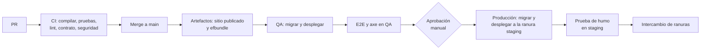

# 13 · Despliegue y operación

El sitio corre en Azure App Service (Linux) con Azure SQL, sin contraseñas en la configuración: todo acceso usa la identidad administrada del sitio. Cada cambio pasa por CI, se despliega solo a QA y llega a producción por una ranura de prueba que se intercambia.

## Recursos de Azure

Un grupo de recursos por entorno (`rg-tiie-qa`, `rg-tiie-prod`). Se definen con Bicep en `infra/`.

| Recurso | Nombre en producción | Configuración inicial |
| --- | --- | --- |
| Plan de App Service | `asp-tiie-prod` | Linux, Premium v3 P0v3, 1 instancia; 2 en temporada |
| App Service | `app-tiie-prod` | .NET 10, *Always On*, HTTPS obligatorio, TLS 1.2+, health check `/salud`, ranura `staging` |
| Azure SQL | `sql-tiie-prod` / `sqldb-tiie` | Uso general; ajustar vCores con la prueba de carga; solo autenticación de Microsoft Entra |
| Key Vault | `kv-tiie-prod` | RBAC, protección contra purga |
| Storage | `sttiieprod` | Contenedor `dataprotection`; bloqueo contra borrado |
| Communication Services | `acs-tiie-prod` + servicio de correo | Dominio propio verificado con SPF y DKIM |
| Application Insights | `appi-tiie-prod` | Sobre un Log Analytics `log-tiie-prod`, retención de 90 días |
| Front Door con WAF | — | Opcional; se evalúa si la temporada lo exige |

QA replica la topología con SKUs menores y sin ranura.

## Identidades y permisos

| Identidad | Recurso | Permiso |
| --- | --- | --- |
| Identidad administrada de `app-tiie-prod` | Azure SQL | Usuario `CREATE USER [app-tiie-prod] FROM EXTERNAL PROVIDER` con `db_datareader` y `db_datawriter`; en `Auditoria` solo `INSERT` y `SELECT` |
| Identidad administrada | Key Vault | *Key Vault Secrets User* y *Key Vault Crypto User* |
| Identidad administrada | Storage | *Storage Blob Data Contributor* sobre `dataprotection` |
| Identidad administrada | Communication Services | Rol con permiso para enviar correo, según la documentación vigente del servicio |
| Pipeline de despliegue (credencial federada OIDC) | Grupo de recursos | *Contributor* para desplegar |
| Pipeline de despliegue | Azure SQL | Usuario con `db_ddladmin` para aplicar migraciones |

La identidad del sitio no puede cambiar el esquema; solo el pipeline puede.

## Configuración

Se define en la configuración de App Service; los secretos son referencias a Key Vault (`@Microsoft.KeyVault(SecretUri=…)`).

| Clave | Valor en producción |
| --- | --- |
| `ConnectionStrings__Tiie` | `Server=tcp:sql-tiie-prod.database.windows.net;Database=sqldb-tiie;Authentication=Active Directory Default;Encrypt=True` |
| `Sitio__UrlPublica` | URL pública del sitio |
| `Sitio__VersionAvisoPrivacidad` | Versión vigente del aviso |
| `Correo__Proveedor` | `Acs` |
| `Correo__AcsEndpoint` | Endpoint de Communication Services |
| `Correo__Remitente` | Dirección del dominio verificado |
| `Captcha__ClaveSitio` | Clave pública de Turnstile |
| `Captcha__ClaveSecreta` | Referencia a Key Vault |
| `DataProtection__BlobUri` | URI del blob de llaves |
| `DataProtection__KeyUri` | URI de la llave en Key Vault |
| `APPLICATIONINSIGHTS_CONNECTION_STRING` | Cadena de Application Insights |
| `ASPNETCORE_ENVIRONMENT` | `Production` |

## CI/CD

Pasos de construcción, en este orden:

1. `npm ci`, `npm run lint`, `npm run typecheck`, `npm test` y `npm run build` en `src/Tiie.Web.Client` (deja la SPA en `wwwroot`).
2. `dotnet build -c Release`, `dotnet test` y comprobación de que `src/api/esquema.d.ts` coincide con `openapi/Tiie.Web.json`.
3. `dotnet publish src/Tiie.Web -c Release -o artifacts/sitio`.
4. `dotnet ef migrations bundle --self-contained -r linux-x64 -o artifacts/efbundle`.

La plataforma puede ser GitHub Actions o Azure Pipelines; ambas soportan credenciales federadas hacia Azure, así que el pipeline no guarda secretos.

## Migraciones

- Se aplican con `efbundle --connection "<cadena con Authentication=Active Directory Default>"` usando la identidad del pipeline, antes de desplegar el código.
- Durante el intercambio de ranuras, el código anterior convive unos minutos con el esquema nuevo. Por eso toda migración es compatible hacia atrás: primero se agrega (columna nueva con valor por omisión, tabla nueva), el código empieza a usarla, y lo viejo se quita en un despliegue posterior.
- Una migración que borra o renombra columnas requiere revisión de dos personas.

## Ranuras y reversión

- `staging` arranca con la configuración de producción (las claves marcadas como de ranura apuntan a lo mismo), responde `/salud` y pasa una prueba de humo: inicio, disponibilidad de una oferta y entrada al panel con un usuario de pruebas.
- El intercambio espera a que `/salud` responda 200 en las instancias calientes.
- **Revertir:** intercambiar de nuevo las ranuras. Como las migraciones son compatibles hacia atrás, el código anterior funciona con el esquema nuevo.

## Dominio y certificados

- Dominio personalizado en App Service con certificado administrado.
- Registros DNS de Communication Services (verificación, SPF y DKIM) en el mismo dominio.
- El dominio y su administrador están en las preguntas abiertas ([01](01-vision-y-alcance.md#preguntas-abiertas)).

## Monitoreo y alertas

| Alerta | Condición | Severidad |
| --- | --- | --- |
| Errores del servidor | Más de 1 % de respuestas 5xx en 5 minutos | Alta |
| Sitio caído | `/salud` falla en 2 instancias de la prueba de disponibilidad | Crítica |
| Reservas anómalas | Más de 5 veces el promedio de reservas por minuto de la última hora | Media |
| Bandeja de correos atrasada | Notificación pendiente con más de 15 minutos | Media |
| Notificaciones descartadas | Cualquiera | Media |
| Proceso diario fallido | `EjecucionProceso` con `Error` o sin correr en 26 horas | Media |
| Bloqueos de cuenta | Más de 10 en 10 minutos | Alta |
| Base de datos saturada | CPU de Azure SQL por encima de 80 % durante 10 minutos | Alta |

Las alertas llegan a un grupo de acción con el correo del equipo; las de severidad crítica también por SMS.

## Respaldos

- Restauración a un punto en el tiempo: 35 días en producción, 7 en QA.
- Retención de largo plazo: semanal por 12 semanas y mensual por 12 meses (propuesta; ajustar con la política de retención).
- Ensayo de restauración cada trimestre en una base temporal, con conteos comparados.

## Runbooks

**Cerrar un módulo de emergencia**

1. En `/admin/bloqueos`, crear un bloqueo del módulo para las fechas afectadas.
2. Revisar las citas afectadas; elegir «Cancelar y avisar» o mantenerlas.

**Reenviar correos descartados**

1. Corregir la causa (por ejemplo, el dominio del remitente).
2. Desde el detalle de cada cita, `Reenviar confirmación`; o, para muchas, ejecutar el script `tools/reencolar-descartadas.sql` (se crea en la Fase 3), que pasa a Pendiente las descartadas de un rango.

**Rotar la clave secreta de Turnstile**

1. Crear la clave nueva en Cloudflare.
2. Guardar una versión nueva del secreto en Key Vault.
3. Reiniciar el sitio para que tome la versión nueva; revocar la anterior.

**Restaurar la base de datos**

1. Restaurar a un punto en el tiempo en una base nueva.
2. Comparar conteos y validar con operación.
3. Apuntar `ConnectionStrings__Tiie` a la base restaurada o renombrar bases; registrar el incidente.

**Desbloquear a un usuario o restablecer su MFA**

1. En `/admin/usuarios/{id}`, «Restablecer MFA» o esperar los 15 minutos del bloqueo.
2. Revisar en la auditoría los intentos fallidos antes de desbloquear.

**Ataque de bots en temporada**

1. Confirmar en Application Insights el patrón (IPs, ofertas, horario).
2. Bajar temporalmente `Limites__Reserva__Permitidas` en la configuración de App Service; el sitio se reinicia solo al guardar.
3. Si persiste, activar Front Door con WAF y reglas de limitación en el borde.
