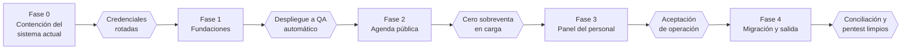

# 15 · Plan de implementación

Cinco fases, cada una con una puerta de salida verificable. La Fase 0 corrige el sistema actual y empieza ya; las fases 1 a 4 construyen la versión 2. Las duraciones se estiman con el equipo al iniciar la Fase 1, historia por historia.

## Fase 0 · Contención del sistema actual

Objetivo: reducir el riesgo del sistema de 2016 mientras se construye la versión 2. La lista está en [11](11-seguridad-y-privacidad.md#fase-0-sistema-actual).

**Puerta:** credenciales rotadas, endpoint de trámites protegido, código desplegado obtenido y consultas de verificación ejecutadas.

## Fase 1 · Fundaciones

| Épica | Historias | Referencias |
| --- | --- | --- |
| E1 Repositorio y CI | H-1.1 Repositorio Git con ramas protegidas y plantillas de PR · H-1.2 CI con compilación, pruebas, lint, contrato, cobertura y escaneo de secretos | [CONTRIBUTING](../CONTRIBUTING.md), [12](12-pruebas.md) |
| E2 Esqueleto | H-1.3 Solución con los cinco proyectos y reglas de arquitectura · H-1.4 SPA servida por ASP.NET Core con *fallback* y proxy de Vite · H-1.5 Problem Details, `codigo` y OpenAPI con tipos generados · H-1.6 Cabeceras de seguridad y filtro CSRF | [04](04-arquitectura.md), [08](08-frontend.md), [09](09-backend.md) |
| E3 Datos | H-1.7 `TiieDbContext`, configuraciones y primera migración del modelo completo · H-1.8 Semilla de desarrollo · H-1.9 Interceptores de marcas de tiempo y auditoría | [05](05-modelo-de-datos.md) |
| E4 Identidad | H-1.10 Entrar con contraseña y MFA · H-1.11 Configurar MFA y códigos de recuperación · H-1.12 Activación y restablecimiento · H-1.13 Políticas, roles y alcance por módulo con prueba de matriz | [07](07-autenticacion-y-autorizacion.md) |
| E5 Entornos | H-1.14 Bicep de QA y producción · H-1.15 Pipeline de despliegue a QA con migraciones · H-1.16 Data Protection compartido, Key Vault y Application Insights | [13](13-despliegue-y-operacion.md) |

**Puerta:** un merge a `main` despliega solo a QA, aplica migraciones y un administrador puede entrar con MFA.

**Estado (2026-10-23):**

| Historia | Estado |
| --- | --- |
| H-1.1 | Repositorio y plantillas listos; falta proteger `main` en la plataforma de Git |
| H-1.2 | `.github/workflows/ci.yml` con compilación, formato, pruebas, cobertura (Dominio 96 %, Aplicación 93 % al 2026-10-23), migraciones, contrato, tamaño, vulnerabilidades y gitleaks |
| H-1.3 a H-1.13 | Implementadas, con pruebas de dominio, aplicación e integración |
| H-1.14 | Bicep de QA y producción en `infra/`, validado con `bicep lint` y `build-params`; falta aplicarlo: necesita la suscripción, el grupo de Entra administrador de SQL y los valores entre `<>` de los parámetros |
| H-1.15 | `.github/workflows/despliegue.yml` con QA, E2E, aprobación, ranura `staging`, prueba de humo e intercambio; falta crear los entornos de GitHub y la credencial federada |
| H-1.16 | El código usa Data Protection en Storage y Key Vault y Application Insights cuando están configurados, y la plantilla crea esos recursos con sus permisos; falta aplicarla |

## Fase 2 · Agenda pública

| Épica | Historias | Referencias |
| --- | --- | --- |
| E6 Catálogo público | H-2.1 Inicio con trámites, requisitos y sedes | RF-01 |
| E7 Cupos y disponibilidad | H-2.2 Generador de cupos y su proceso · H-2.3 Disponibilidad por día y cupos por fecha | RF-02, RN-02 a RN-08 |
| E8 Reserva | H-2.4 Asistente de cuatro pasos · H-2.5 Reserva atómica con idempotencia, captcha y límites | RF-03, RN-01, RN-09, RN-10, RN-15 |
| E9 Mi cita | H-2.6 Token, intercambio por cookie y consulta · H-2.7 Comprobante PDF · H-2.8 Cancelar y reprogramar · H-2.9 Recuperar enlace | RF-04, RF-05, RF-06, RN-13, RN-16, RN-17 |
| E10 Notificaciones | H-2.10 Bandeja de salida con reintentos y plantillas · H-2.11 Recordatorios | RF-04, RF-07, RN-14 |
| E11 Privacidad | H-2.12 Aviso de privacidad versionado | RF-08 |
| E12 Calidad | H-2.13 Pruebas de concurrencia y de reloj · H-2.14 E2E y accesibilidad · H-2.15 Prueba de carga | [12](12-pruebas.md) |
| E22 Experiencia del ciudadano | H-2.16 Portada orientada a la tarea · H-2.17 Agendar desde una sede · H-2.18 Requisitos antes del horario · H-2.19 Calendario legible y «Lo más pronto» · H-2.20 Horas por turno · H-2.21 Navegación del asistente · H-2.22 Datos con retroalimentación · H-2.23 Comprobante que no se olvida · H-2.24 Mi cita sin sesión · H-2.25 Embudo anónimo · H-2.26 Pruebas con usuarios · H-2.27 Identidad institucional · H-2.28 Sede más cercana · H-2.29 Modo oscuro | [16](16-experiencia-de-usuario.md#backlog-de-producto), RF-01 a RF-06 |

**Puerta:** en QA, la prueba de carga de apertura de temporada termina con cero sobreventa y dentro de los tiempos de RNF-06; E2E y axe en verde.

**Estado (2026-10-23):** H-2.1 a H-2.13 implementadas en backend y SPA, con pruebas de dominio, integración (concurrencia, reloj, idempotencia, privacidad) y de componentes. H-2.14: las 9 pruebas E2E con axe de `tests/e2e` pasan en local con Edge, en celular y escritorio (21 de 21 el 2026-10-23); en QA, los flujos 4 y 9 se omiten mientras no haya buzón de prueba. H-2.15: los escenarios de k6 de `tests/carga` están escritos y solo revisados de sintaxis. La puerta se cumple al correr ambos en QA. E22: H-2.16 a H-2.24 implementadas en la SPA con pruebas de componentes; H-2.25 a H-2.29 pendientes, y H-2.26 y H-2.27 son condición para abrir la agenda al público.

## Fase 3 · Panel del personal

| Épica | Historias | Referencias |
| --- | --- | --- |
| E13 Catálogos | H-3.1 Módulos · H-3.2 Tipos de trámite y requisitos por nivel · H-3.3 Ofertas | RF-12, RF-13 |
| E14 Horarios | H-3.4 Editor de plantilla semanal con resumen de impacto · H-3.5 Bloqueos con citas afectadas y cancelación en bloque · H-3.6 Vista y ajuste de cupos | RF-14, RF-15 |
| E15 Operación diaria | H-3.7 Agenda del día y asistencia · H-3.8 Cita en ventanilla · H-3.9 Cancelar, reprogramar y reenviar desde el panel · H-3.10 Corrección de asistencia | RF-09, RF-10, RF-11, RN-12, RN-18 |
| E16 Información | H-3.11 Reportes con exportación · H-3.12 Tablero | RF-17, RF-18 |
| E17 Administración | H-3.13 Usuarios, invitaciones y restablecimiento de MFA · H-3.14 Bitácora de auditoría y estado de procesos | RF-16, RF-19 |
| E18 Procesos | H-3.15 Cierre diario · H-3.16 Retención (desactivada hasta definir el plazo) | RF-20 |

**Puerta:** supervisores y capturistas aprueban en QA una semana simulada de operación; revisión contra OWASP ASVS nivel 2 sin pendientes altos.

**Estado (2026-10-23):** H-3.1 a H-3.16 implementadas, con la matriz de autorización probada en cada endpoint de `/api/admin` y pruebas de componentes del panel. H-3.16 (retención) existe desactivada hasta definir el plazo. Falta la semana simulada con operación y la revisión ASVS.

## Fase 4 · Migración y salida

| Épica | Historias | Referencias |
| --- | --- | --- |
| E19 Migración | H-4.1 Herramienta `Tiie.Migracion` con análisis, migración y conciliación · H-4.2 Ensayos 1 y 2 con operación | [14](14-migracion-de-datos.md) |
| E20 Seguridad | H-4.3 Prueba de penetración externa y correcciones | [11](11-seguridad-y-privacidad.md) |
| E21 Salida | H-4.4 Manuales breves y capacitación del personal · H-4.5 Corte, monitoreo reforzado y archivo de la base anterior | [13](13-despliegue-y-operacion.md), [14](14-migracion-de-datos.md) |

**Puerta:** conciliación sin diferencias sin explicar, prueba de penetración sin hallazgos altos o críticos y prueba de humo en producción aprobada.

**Estado (2026-10-23):** H-4.1 implementada en `tools/Tiie.Migracion` (analizar, migrar, conciliar y avisar) con pruebas unitarias y de punta a punta. El esquema de 2016 que lee es supuesto: se valida contra el script real antes del ensayo 1. H-4.2 a H-4.5 dependen de una copia de producción, del proveedor de la prueba de penetración y de operación.

## Definición de terminado

Una historia está terminada cuando:

- [ ] Cumple sus criterios de aceptación de [02](02-requerimientos.md) y las reglas que cita.
- [ ] Tiene pruebas automatizadas; las reglas `RN-xx` llevan su ID en el nombre de la prueba.
- [ ] Los endpoints nuevos tienen política y están en la matriz de autorización.
- [ ] No registra datos personales sin enmascarar.
- [ ] La interfaz funciona con teclado, en celular y sin hallazgos graves de axe.
- [ ] La documentación afectada se actualizó en el mismo PR.
- [ ] Está desplegada en QA y la revisó otra persona.

## Equipo sugerido

| Rol | Dedicación | Responsabilidad |
| --- | --- | --- |
| Líder técnico .NET | Completa | Arquitectura, revisiones, seguridad, despliegue |
| Desarrollo de pila completa | 1 o 2 personas, completa | Historias de las fases 1 a 4 |
| QA | Parcial | Pruebas E2E, de carga y de aceptación |
| Representante de operación | Parcial | Reglas, prioridades y aceptación en QA |
| Área jurídica | Puntual | Aviso de privacidad, retención y menores de edad |
