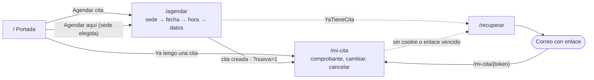

# 16 · Experiencia de usuario y diseño del sitio público

Diseño de la portada y del servicio de citas: el asistente de reserva, «Mi cita» y la recuperación del enlace. El panel `/admin` tiene su propio documento ([17](17-experiencia-del-panel.md)) y comparte con el sitio los tokens y los componentes base. Las reglas siguen en el backend ([03](03-reglas-de-negocio.md)): la interfaz las explica, nunca las decide.

## Problema

Una evaluación heurística del primer diseño, con datos de ejemplo en un celular de 390 px y en escritorio, encontró:

| Hallazgo | Efecto en la persona |
| --- | --- |
| La portada era una lista larga de textos: trámites con todos sus requisitos abiertos y sedes una debajo de otra | En celular había que desplazarse más de 10 pantallas para ver las sedes; nada guiaba a la acción |
| Los requisitos solo aparecían después de reservar | Se agendaba sin saber qué llevar; riesgo de acudir sin documentos y perder el lugar |
| El calendario indicaba la disponibilidad con negritas, subrayado punteado y tachado, y tachaba también los días pasados | Difícil de leer; el mes actual se veía casi todo tachado |
| «Continuar» quedaba al final de listas largas | En celular había que desplazarse para encontrarlo |
| No había forma de volver a un paso desde el indicador de progreso | Para cambiar la sede desde «Tus datos» había que regresar paso por paso |
| Un error de dedo en el correo pasaba sin aviso | El correo es el único acceso a la cita (RN-16): un dominio mal escrito deja a la persona sin enlace |
| La confirmación era una lista de datos | Ni el folio ni la fecha y hora destacaban; nada ayudaba a no olvidar la cita |
| «Mi cita» sin cookie mostraba «Este enlace ya no es válido» aunque nadie hubiera abierto un enlace | Mensaje falso para quien llega desde el menú |
| Sin identidad visual ni señal de sitio oficial | Poca confianza para capturar CURP y datos de contacto |

## Objetivos y métricas

Los objetivos de producto vienen de [01](01-vision-y-alcance.md#objetivos); el diseño los vuelve medibles:

| Objetivo | Indicador | Meta propuesta | Cómo se mide |
| --- | --- | --- | --- |
| Reserva sencilla | Tiempo de la portada a «Tu cita quedó agendada» en celular | Menos de 3 minutos, mediana | Pruebas con usuarios (H-2.26) |
| Reserva sencilla | Reservas creadas ÷ visitas a `/agendar` | 70 % o más | Embudo anónimo (H-2.25) |
| Menos inasistencia | Citas No asistió ÷ citas del día | Bajar respecto del sistema de 2016 | Tablero (RF-18) |
| Lugares bien usados | Cancelaciones hechas antes del día de la cita | Subir | Reportes (RF-17) |
| Acceso a la cita | Solicitudes de recuperación ÷ citas creadas | Menos de 10 % | Bitácora de recuperación (RF-06) |
| Accesibilidad | Hallazgos graves o críticos de axe | 0 | E2E ([12](12-pruebas.md)) |
| Rendimiento | JavaScript inicial comprimido | Menos de 200 KB (hoy 124 KB) | `npm run tamano` en CI |

## Personas

| Persona | Contexto | Lo que necesita |
| --- | --- | --- |
| **Estudiante** de preparatoria o universidad, 15 a 24 años | Celular Android de gama media con datos móviles; agenda entre clases | Rapidez: el día más próximo, pocos campos y la cita en su calendario |
| **Madre, padre o tutor** que agenda para una hija o hijo de primaria o secundaria | Menos familiaridad con trámites en línea; a veces comparte el celular | Saber qué llevar y cuánto cuesta antes de comprometerse; textos claros; confianza para dar la CURP |
| **Persona con cita** | Quiere verla, cambiarla o cancelarla, a veces días después y desde otro equipo | Llegar a su cita sin cuenta, o recuperar el enlace sin exponer sus datos |

## Principios

1. **Una tarea por pantalla y una acción principal.** Cada paso tiene un solo botón primario.
2. **Primero el celular.** Objetivos de 44 px o más, acciones al alcance del pulgar y una barra fija con «Continuar».
3. **Lo antes posible.** La mayoría quiere el primer día con lugar: se ofrece como atajo antes del calendario.
4. **Sin sorpresas.** Costo y requisitos se ven al elegir el trámite, antes de comprometer un horario.
5. **El color nunca va solo.** Cada estado lleva texto, forma (punto lleno, aro, tachado) o ícono.
6. **Confianza visible.** Franja de sitio oficial, aviso de privacidad simplificado junto al formulario y ninguna consulta por CURP.
7. **El servidor decide.** Los textos no fijan plazos ni límites configurables: la fecha límite para cambios llega de la API (`modificableHasta`) y el rango del calendario de la disponibilidad.
8. **El rendimiento es parte del diseño.** Sin fuentes externas (la CSP solo permite `font-src 'self'`), sin fotografías y con ilustraciones en SVG en línea.

## Mapa del sitio y recorridos

| Momento | Pregunta de la persona | Respuesta del diseño |
| --- | --- | --- |
| Llega a la portada | ¿Aquí saco la cita de la TIIE? | Título con la tarea, botón «Agendar cita» visible sin desplazarse y franja de sitio oficial |
| Explora | ¿Qué llevo? ¿Cuánto cuesta? ¿Dónde? | Trámites con costo y requisitos plegables; sedes con horario, «Cómo llegar» y «Agendar aquí» |
| Elige sede y trámite | ¿Me sirve este trámite? | Descripción y costo en cada opción; al elegir, «Lo que deberás llevar a tu cita» |
| Elige día | ¿Cuándo es lo más pronto? | «Lo más pronto» con los tres primeros días con lugar; calendario con punto y aro |
| Elige hora | ¿Hay en la mañana? | Horas agrupadas en Mañana y Tarde, con lugares restantes y «Último lugar» |
| Escribe sus datos | ¿Lo escribí bien? | «CURP válida» con la fecha de nacimiento y el sexo derivados; «¿Quisiste decir …?» para el correo |
| Confirma | ¿Ya quedó? ¿Cómo no la olvido? | Confirmación con ícono, comprobante tipo boleto, cuenta regresiva, copiar folio y agregar al calendario |
| Vuelve después | ¿Cómo entro a mi cita? | «Consulta tu cita» explica el enlace del correo y ofrece enviarlo de nuevo |

## Sistema de diseño

### Color

Tokens en `src/styles/index.css` (`@theme`). Guinda es la marca y las acciones; dorado solo decora.

| Token | Valor | Uso | Contraste |
| --- | --- | --- | --- |
| `guinda-700` | `#7b1e3a` | Botón primario, enlaces, elegido | 10:1 sobre blanco |
| `guinda-800`, `guinda-900` | `#63172f`, `#4a1123` | Hover, franja oficial, boleto, llamada final | Texto blanco 12:1 o más |
| `guinda-50`, `guinda-100` | `#fbf2f4`, `#f5e1e6` | Fondos de elegido y de íconos | — |
| `dorado-400` | `#bc955c` | Íconos y detalles decorativos | No se usa para texto |
| `dorado-700` | `#6e522c` | Texto dorado, si hace falta | 7.2:1 sobre blanco |
| `emerald-600/50` | — | «Hay lugares», «Sin costo», éxito | Punto 3.8:1 |
| `amber-600/50` | — | «Quedan pocos», «Último lugar», avisos | Aro 3.2:1; el texto usa `amber-800` |
| `slate-50 … 950` | — | Fondo, texto y bordes | Texto secundario `slate-600`; el mínimo es `slate-500` (4.5:1 sobre `slate-50`) |

### Tipografía, espacio y forma

- Tipografía del sistema (`ui-sans-serif, system-ui, …`): cero descargas y se ve nativa en cada teléfono. Si Gobierno define una tipografía institucional, se sirve desde el propio sitio por la CSP.
- Escala: portada 36 a 54 px (`text-4xl` a `text-[3.4rem]`, peso 800); título de paso 30 a 36 px; título de sección 30 a 36 px; texto 16 a 18 px con interlineado amplio. Títulos con `text-wrap: balance`.
- Radios: 8 px en botones, 12 px en campos y opciones, 16 a 24 px en tarjetas. Sombras `shadow-tarjeta` y `shadow-elevada`.
- Ancho de lectura con `Contenedor`: `angosto` (672 px) para mensajes y textos legales, `medio` (768 px) para Mi cita, `amplio` (1152 px) para la portada y el asistente.

### Componentes

| Componente | Archivo | Para qué |
| --- | --- | --- |
| `Boton` y `estiloBoton()` | `components/ui/Boton.tsx` | Variantes primario, secundario, enlace, peligro, destructivo y claro; tamaño `grande` para acciones del ciudadano. `estiloBoton()` da el mismo aspecto a un `Link` |
| `Icono` | `components/ui/Icono.tsx` | Íconos de trazo propios, siempre `aria-hidden` |
| `Insignia` | `components/ui/Insignia.tsx` | Costo y estado de la cita, con texto |
| `Alerta` | `components/ui/Alerta.tsx` | Error, éxito, aviso e información, con ícono |
| `Campo` | `components/ui/Campo.tsx` | Etiqueta, ayuda, error y `confirmacion` positiva |
| `GrupoOpciones` | `components/ui/GrupoOpciones.tsx` | Radios visibles en tarjetas o en chips, con número de pregunta |
| `Contenedor` | `components/ui/Contenedor.tsx` | Ancho y márgenes de cada pantalla |
| `CalendarioDisponibilidad` | `components/CalendarioDisponibilidad.tsx` | «Lo más pronto» y calendario con punto, aro y tachado |
| `SelectorHora` | `components/SelectorHora.tsx` | Horas por turno; foco visible aunque el radio esté oculto |
| `Requisitos` | `components/Requisitos.tsx` | Lista para revisar, agrupada por nivel escolar |
| `Marca` | `components/Marca.tsx` | Logotipo del sitio |
| `EstadoVacio` | `features/publico/comun/EstadoVacio.tsx` | Pantallas de un solo mensaje |
| `BarraAcciones` | `features/publico/agendar/BarraAcciones.tsx` | Acciones fijas al pie en celular |

## Pantallas

### Marco común

- Franja «Sitio oficial del Gobierno del Estado de Sinaloa» y encabezado fijo con Trámites, Sedes, Preguntas (escritorio), «Mi cita» y «Agendar» (se oculta dentro del asistente).
- Pie con enlaces a las tareas y a la información, y el aviso de privacidad.
- «Ir al contenido» lleva el foco a `<main>`.

### Portada (`/`)

0. **Aviso** (opcional): franja sobre la portada con un ícono y el texto, informativa (guinda clara) o importante (ámbar). Solo aparece entre sus fechas.
1. **Portada:** título con la tarea, entrada de dos líneas, «Agendar cita» y «Ya tengo una cita», tres beneficios (sin cuenta, comprobante por correo, cambia o cancela en línea) e ilustración estilizada de la tarjeta, decorativa. Mientras llega el texto, unas barras ocupan su lugar para que los botones no se muevan.
2. **Agenda en cuatro pasos:** qué esperar del proceso.
3. **Trámites y requisitos:** tarjetas con costo; requisitos en un `
` con su número.
4. **Sedes de atención:** cuadrícula ordenada por municipio, con filtro por municipio cuando hay más de uno. Cada sede tiene «Agendar aquí» (`/agendar?municipio=…&modulo=…`) y «Cómo llegar».
5. **Preguntas frecuentes:** acordeón con `
`. Las respuestas no fijan plazos configurables.
6. **Llamada final** con «Agendar mi cita».

Los anclas del encabezado (`/#sedes`) funcionan también al navegar dentro de la SPA.

#### Contenido editable

El administrador cambia desde el panel ([17](17-experiencia-del-panel.md#portada-del-sitio)) lo que más cambia con la operación, sin un despliegue. El resto de la portada describe cómo funciona el sitio y sigue en el código ([ADR 0008](adr/0008-contenido-editable-de-la-portada.md)).

| Se edita | Queda fijo |
| --- | --- |
| Etiqueta, título, continuación del título y descripción del encabezado | Botones, beneficios e ilustración |
| Aviso: texto, tono y fechas | «Agenda en cuatro pasos» |
| Preguntas frecuentes: hasta 20, en orden | Trámites y sedes, que vienen de sus catálogos |
| | Llamada final, encabezado y pie del sitio |

- **Texto plano con enlaces.** Se escribe `[texto](destino)` y el destino empieza con `/`, `https://`, `mailto:` o `tel:`; la API rechaza los demás y la SPA nunca interpreta HTML. Los enlaces externos abren en otra pestaña y lo dicen a los lectores de pantalla.
- **Contenido predeterminado.** Es el texto con el que se diseñó la portada; se muestra mientras nadie guarde otro.
- **Si la API falla,** la portada conserva su título y sus botones y las preguntas dicen que no se pudieron cargar.

### Asistente (`/agendar`)

- **Progreso:** cuatro pasos numerados; los hechos muestran ✓ y son botones para volver sin perder lo elegido. El actual lleva `aria-current="step"`.
- **Resumen de tu cita:** tarjeta fija a la derecha en escritorio, con «Por elegir» en lo que falta; en celular, un resumen compacto bajo el título de cada paso.
- **Sede y trámite:** municipio en chips; sede y trámite en tarjetas con radio visible. Al elegir, la siguiente pregunta se desplaza a la vista. Al elegir el trámite aparece «Lo que deberás llevar a tu cita». «Continuar» vive en la barra fija y explica por qué está deshabilitado.
- **Fecha:** el rango viene de la API («Puedes agendar del … al …»). «Lo más pronto» ofrece los tres primeros días con lugar; el calendario marca con fondo verde y punto los días con lugares, con fondo ámbar y aro los de pocos lugares, tacha los llenos o cerrados y atenúa sin tachar los que no se ofrecen. Los días cerrados listan su motivo.
- **Hora:** Mañana y Tarde; cada hora dice cuántos lugares quedan o «Último lugar»; la elegida se rellena y lleva ✓.
- **Tus datos:** dos bloques, «¿Quién hará el trámite?» y «¿Dónde te avisamos?». La CURP se ve en mayúsculas y, al ser válida, confirma la fecha de nacimiento y el sexo que se derivan de ella (RN-15). Al salir del correo, si el dominio se parece a uno común, ofrece «¿Quisiste decir …?» sin corregir solo (`lib/correo.ts`). Debajo, el aviso simplificado y el captcha.
- Los mensajes de los errores de la API no cambian ([08](08-frontend.md#asistente-de-reserva)); `SinCupo` y `FueraDeVentana` regresan al paso con un aviso en tono ámbar.

### Mi cita (`/mi-cita`)

- Con `?nueva=1`: confirmación verde con ícono y el correo enmascarado al que se envió.
- **Comprobante tipo boleto:** folio con «Copiar folio», cuenta regresiva («Faltan 3 días», «Es mañana», «Es hoy»), fecha y hora grandes, sede con «Cómo llegar» y trámite con costo. Acciones: «Descargar comprobante (PDF)» y «Agrégala a tu calendario» con Google Calendar o un archivo `.ics` para Apple y Outlook. El evento dura 30 minutos, avisa un día antes y no lleva datos personales (`mi-cita/calendario.ts`).
- Secciones «Lleva estos requisitos», «Persona que hará el trámite» (datos enmascarados) y «¿Cambio de planes?» con el plazo de la API; «Cancelar cita» usa el estilo de peligro y el diálogo confirma con un botón destructivo.
- Una cita que ya no está agendada se explica: cancelada o no asistida ofrecen agendar otra; reprogramada remite al correo más reciente.
- **Sin cookie:** «Consulta tu cita» explica que se entra con el enlace del correo, que no se pide la CURP por privacidad, y ofrece «Enviarme el enlace de nuevo». **Enlace vencido** (`?error=enlace-invalido`): «Este enlace ya no es válido» con «Recuperar mi enlace».

### Recuperar (`/recuperar`)

Formulario en tarjeta y, al lado, «¿Cómo funciona?» en tres pasos y la nota de privacidad. La respuesta es la misma exista o no la cita (RF-06).

## Redacción

- Se habla de tú, en frases cortas y con verbos: «Elige el día», «Agendar cita», «Cambiar día».
- Fechas largas en texto («martes 27 de octubre de 2026») y horas `HH:mm` de Sinaloa.
- Cada error dice qué pasó y qué hacer; nunca culpa a la persona.
- «Sede» al elegir dónde; «módulo» para el lugar físico y su personal.
- Los textos con reglas configurables remiten a la cita («En tu cita verás hasta qué día…») en lugar de fijar el plazo.
- Las pruebas E2E dependen de varios textos exactos (títulos de paso, «Continuar», «Agendar cita», «Tu cita quedó agendada», estados). Ninguna otra etiqueta de la misma pantalla debe contenerlos: Playwright compara por subcadena.

## Accesibilidad

Además de lo que exige [08](08-frontend.md#accesibilidad):

- Radios visibles en sede y trámite; en las horas el radio está oculto y la tarjeta muestra el foco del teclado (`has-[:focus-visible]`).
- Nombre accesible que contiene la etiqueta visible: «Agendar aquí en Módulo …», «Google Calendar (abre en una pestaña nueva)».
- Números grandes decorativos en CSS (`content: attr(data-numero)`), no como texto.
- La barra fija respeta el área segura de iOS y el foco no queda debajo del encabezado (`scroll-padding-top`).
- Al abrir «Cambiar fecha u hora», el foco va al título del panel.
- El calendario se maneja con flechas y anuncia «jueves 12 de noviembre, poca disponibilidad»; los atajos anuncian «… (poca disponibilidad)».

## Backlog de producto

Épica **E22 Experiencia del ciudadano**, en la Fase 2 ([15](15-plan-de-implementacion.md#fase-2--agenda-pública)). Prioridad MoSCoW.

| Historia | Como… quiero… para… | Criterios de aceptación | Prioridad | Estado |
| --- | --- | --- | --- | --- |
| H-2.16 Portada orientada a la tarea | Ciudadano: entender en segundos qué hago aquí y empezar | «Agendar cita» visible sin desplazarse en 390 × 844; trámites con costo; requisitos plegables; preguntas frecuentes | Must | Hecha |
| H-2.17 Agendar desde una sede | Ciudadano: empezar con mi sede ya elegida | «Agendar aquí» abre el asistente con municipio y sede marcados | Should | Hecha |
| H-2.18 Requisitos antes del horario | Tutor: saber qué llevar antes de elegir día | Al elegir el trámite se muestran sus requisitos | Must | Hecha |
| H-2.19 Calendario legible y «Lo más pronto» | Estudiante: la fecha más próxima en un toque | Tres primeros días con lugar como atajo; estados con punto, aro o tachado y texto | Must | Hecha |
| H-2.20 Horas por turno | Ciudadano: encontrar una hora de la mañana o la tarde | Mañana y Tarde; «Último lugar» cuando queda uno | Should | Hecha |
| H-2.21 Navegación del asistente | Ciudadano: corregir un paso sin rehacer todo | Pasos hechos como botones; resumen lateral en escritorio; «Continuar» fijo en celular | Must | Hecha |
| H-2.22 Datos con retroalimentación | Ciudadano: saber que escribí bien | «CURP válida» con lo derivado; sugerencia de dominio al salir del correo | Must | Hecha |
| H-2.23 Comprobante que no se olvida | Ciudadano: tener mi cita a la mano | Boleto con cuenta regresiva, copiar folio, Google Calendar y `.ics` | Should | Hecha |
| H-2.24 Mi cita sin sesión | Persona con cita: saber cómo entrar | Sin cookie: «Consulta tu cita» con «Enviarme el enlace de nuevo»; estados finales explicados | Must | Hecha |
| H-2.25 Embudo anónimo | Equipo: saber en qué paso se abandona | Conteo por paso sin datos personales ni identificadores; decisión de herramienta y CSP | Should | Pendiente |
| H-2.26 Pruebas con usuarios | Equipo: validar la meta de 3 minutos | 5 personas por perfil en celular; hallazgos priorizados | Must antes de abrir al público | Pendiente |
| H-2.27 Identidad institucional | Gobierno: que el sitio cumpla sus lineamientos | Logotipo, tipografía e imagen de la tarjeta aprobados por Comunicación Social | Must antes de abrir al público | Pendiente |
| H-2.28 Sede más cercana | Ciudadano: ordenar sedes por distancia | Ubicación opcional; requiere cambiar `Permissions-Policy` (hoy `geolocation=()`) | Could | Pendiente |
| H-2.29 Modo oscuro | Ciudadano: leer de noche | Tokens para `prefers-color-scheme: dark` con contraste AA | Could | Pendiente |
| H-2.30 Aviso en la portada | Ciudadano: enterarme de un cierre o cambio antes de agendar | Franja informativa o importante sobre la portada, solo entre sus fechas en la hora de Sinaloa; con enlaces | Must | Hecha |

## Preguntas abiertas de diseño

También están en [01](01-vision-y-alcance.md#preguntas-abiertas).

| Pregunta | Valor mientras se decide |
| --- | --- |
| ¿Cuáles son los lineamientos de identidad gráfica del Gobierno de Sinaloa (logotipo, tipografía, imagen de la TIIE)? | Guinda `#7b1e3a`, tipografía del sistema e ilustración estilizada de una tarjeta |
| ¿Cuánto dura la atención en el módulo? | 30 minutos para el evento de calendario (`DURACION_MINUTOS`) |
| ¿Quién valida el texto de las preguntas frecuentes? | Texto basado en las reglas vigentes; lo revisa la operación antes de abrir |

## Cómo se verifica

- Vitest cubre los comportamientos nuevos: atajos de fecha, turnos, pasos navegables, enlace desde la sede, requisitos al elegir trámite, CURP válida, sugerencia de correo, filtro de sedes, cuenta regresiva, copiar folio, calendario y estados de Mi cita.
- Las pruebas E2E con axe de `tests/e2e` siguen siendo la puerta de accesibilidad en celular y escritorio.
- Para revisar el diseño sin backend se puede abrir `npm run dev` con la API simulada por Playwright (`page.route`), como se hizo para las capturas de este cambio.
